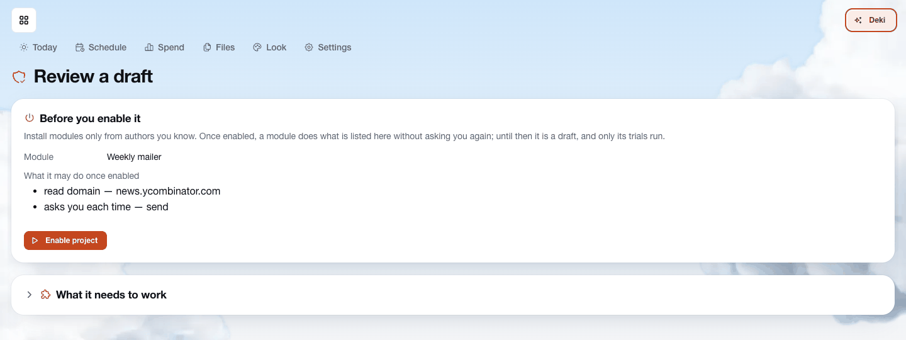

<div align="center">

# deck

### Your AI agents do the routine. You only say yes.

A personal control panel that runs Claude Code, Codex and local models on your recurring work —<br>
on your own machine, in a sandbox, with every outbound step waiting for your one tap.


</div>

## Why deck

Coding agents are good enough to do real work. Sitting in a chat to start each run is not. deck turns a routine —
reading sources, watching prices, triaging pull requests, making short videos — into a **module**: a routine deck
runs for you, with its own data, screen, scripts and agent commands, on a schedule, its result on a card. You open
deck in the morning, see what was done, and answer the one or two things that need you.

- **Ask for a module in words.** Deki, deck's built-in assistant that builds and changes modules, interviews you for
  a minute, builds the module (data, commands, schedule, screens, widgets), tries it as a draft and hands it over.
  Later you just tell it what to change.
- **Nothing important happens behind your back.** Anything that leaves the machine, spends money or widens a
  module's rights waits for your yes, and a button you press already is that yes. What agents changed on their own
  is one line per run under **Done without you**, with an undo.
- **Your models, your bill.** Subscriptions (Claude Code, Codex) or any model on OpenRouter, Google, Anthropic,
  Groq, a local server or Ollama, each command on its own model with fallbacks. **Spend** shows what every module
  costs.
- **Yours.** One program, one folder, no account, no cloud. Keys stay in deck: each module reads only its own secrets,
  and no module reads the API keys of model connections. A subscription login (Claude Code, Codex) is a right of its
  own a module declares and you grant; an agent that runs on that CLI can still read and rewrite its login file, so
  grant it only to modules you trust.

## A look inside

<table>
<tr>
<td width="50%"><br><sub><b>Deki beside a module.</b>
The chat sees the screen; a reply can carry a block — a chart, a table, a form or options to pick.</sub></td>
<td width="50%"><br><sub><b>Today.</b>
What waits for you comes first, one at a time, and is answered right there.</sub></td>
</tr>
<tr>
<td width="50%"><br><sub><b>A draft before enabling.</b>
A module someone else made comes as a draft that says what it may do; only its trials run until you enable it.</sub></td>
<td width="50%" align="center"><br><sub><b>On a phone.</b>
The same tiles and a tab bar for the thumb; added to the home screen, deck gets pushes and shared links.</sub></td>
</tr>
</table>

## What you get

- **Tiles and live widgets.** The home is a grid of cards you arrange like a phone's, per device. A module's card is
  a small screen of its own data (stats, lists, charts) that updates the moment the data changes; for a size the
  module has no view for, **Draw a widget** asks Deki to design one. **Today** is deck's own card: what waits, failed,
  runs and was done, and what the day cost.
- **Deki.** A side chat next to any screen that sees what you look at. One line shows what it is
  doing now, with a timer, the model and Stop; questions come as cards; long work goes to a process of its own. A
  reply can show a block of the catalog under its text, and your press is the answer.
- **Memory.** Deki keeps the facts you told it and lessons from what went wrong, finds them by search, and goes over
  the day each night (sleep): it confirms or retires lessons and proposes fixes. Settings → Memory shows what it keeps
  and lets you edit or delete it.
- **Modules are data.** A manifest, prompts, skills and small scripts — no code in deck. Export to a `.zip` without
  your data or secrets; import as a draft that shows what it needs and what it may do before you enable it.

## Under the hood

- **One binary, one door.** About 70k lines of Go with SQLite and the React client embedded. Buttons, the API,
  schedules, scripts and agents all call the same commands through one registry, so rights, confirmations, the
  journal and the undo are enforced in one place.
- **MCP-native.** Every agent process gets its own deck MCP server: the commands it may call as tools, questions and
  confirmations to the owner, nothing else. Scripts get an HTTP entry with a per-run token.
- **Sandboxed, with one way out.** Every program of a module — a script, an MCP server, Claude Code, Codex, an ACP
  agent — runs in a box of its own (bubblewrap) that sees only its folders and reaches only the hosts its rights name,
  through deck's proxy, which holds the model keys. A host a module may read is a host it may send to; clicking and
  submitting in the browser waits for your consent.
- **Screens are data.** JSON resolved on the server into [A2UI](https://github.com/google/A2UI) messages from a catalog
  of blocks; a committed write publishes its topic and the client refreshes over SSE only what changed. Anything the
  catalog lacks is an [MCP App](https://github.com/modelcontextprotocol/ext-apps) on a second origin.
- **Any agent behind one interface.** The Claude Code CLI, the Codex app-server and any ACP agent such as Goose on a
  local model. A refused or silent turn goes to the next model of the assignment.
- **Tested end to end.** About 1,100 scenario tests through the real registry on a real SQLite with a fake provider;
  behind flags, the same against the real Claude Code, Codex, a local model and a real browser.

The full picture is in [docs/architecture.md](docs/architecture.md).

## Install

One way for every machine: Docker with compose and deck's image, with Claude Code, Codex, uv and a browser inside.
You need first:

- **Linux:** [Docker Engine](https://docs.docker.com/engine/install/) with the compose plugin, your user in the group
  `docker` ([how](https://docs.docker.com/engine/install/linux-postinstall/)).
- **Mac:** [OrbStack](https://orbstack.dev) or Docker Desktop.
- **Windows:** Docker Desktop with WSL 2 (not tried yet, see [docs/install.md](docs/install.md#windows)).

Then, as your user and not with `sudo` (under `sudo` it would put deck in root's home, `/root/deck`):

```bash
curl -fsSL https://raw.githubusercontent.com/teaarte/deck/master/install.sh | sh
```

It puts deck in `~/deck` (`DECK_DIR` for another folder), loads the AppArmor profile on Ubuntu and Debian (`sudo` asks
once, for that alone), starts deck and prints a link that pairs your device (on a server, see "On a server" below first). By hand:

```bash
mkdir deck && cd deck
v=$(curl -fsSLo /dev/null -w '%{url_effective}' https://github.com/teaarte/deck/releases/latest); v=${v##*/}   # the latest release
for f in compose.yaml seccomp.json deck-box.apparmor move-to-docker.sh; do curl -fsSLO https://raw.githubusercontent.com/teaarte/deck/$v/$f; done
# Ubuntu and Debian, once: the AppArmor profile the container runs under
sudo install -m644 deck-box.apparmor /etc/apparmor.d/deck-box && sudo apparmor_parser -r /etc/apparmor.d/deck-box
docker compose up -d
docker compose exec deck deck pair        # a link that pairs a device
```

deck restarts with Docker and the machine; its data and the agents' logins stay in the volume `deck`. Its settings
are the file `.env` beside `compose.yaml` (in `~/deck`); the installer keeps an existing one.

**Memory and processes.** The image takes about 2.3 GB of disk; deck alone holds a few hundred MB of memory, each
agent at work and the browser more. The container runs at most 4096 processes. Its memory has no ceiling unless you
give one, as `DECK_MEM_LIMIT=6g` in `.env`: then memory eaten past it kills a process inside deck's container, deck
itself maybe (Docker starts it again), instead of the host's other services. A deck that stops answering on its port
shows as `unhealthy` in `docker compose ps`; a monitor outside the machine, such as an uptime check of deck's https
address, tells you when the machine itself is down.

**First steps.** Open the link, then sign in to the agents in Settings → Models → **Sign in** (Codex shows a link and a
code, Claude Code a link whose page gives the code). An empty deck says "Tell Deki what to do": describe a routine in
the chat and Deki builds the module, or add the starter module it offers as a draft. The models, agents and folders of
your own computer reach deck in the container through a [node](docs/node.md): the deck binary on your Mac, outside
Docker, that lends deck its local models and folders.

**Signing in.** There is no password and no owner token. A device pairs once by a link of `deck pair` (or of Settings →
Devices on a device already signed in, with a QR code for a phone) and makes a passkey; the link works once, within
ten minutes. Settings → Devices lists every device and passkey: revoking a device signs out that browser alone,
revoking a passkey every browser that used it. An answer that trusts for long — always to a serious right, enabling
a draft, a new token, a link that pairs a device — takes a touch of the passkey within five minutes; once, no and a
revoke take none. An automation token calls the commands of deck it lists, in the modules its rights name.

**On this machine** deck is <http://deck.localhost:7700>: browsers treat `deck.localhost` as secure, so a passkey works
there without https (tried in Chromium and Safari). That address opens only on the machine deck runs on.

**On a server**, give deck its https address before you pair: in `~/deck`, put it in `.env`, run
`docker compose up -d`, then `docker compose exec deck deck pair`, which prints the https link first.

- With a domain pointing at the server (ports 80, 443 and 8443 open), Caddy in the same compose gets the certificate:
  `printf 'DECK_DOMAIN=deck.example.com\nCOMPOSE_PROFILES=domain\n' > .env`. More in
  [docs/install.md](docs/install.md#a-server-with-a-domain).
- Without a domain, Tailscale gives the address, below.

**From a phone and other devices**, deck needs https: your domain as above, or Tailscale on deck's machine and on the
device:

1. Install Tailscale on deck's machine and sign it in: on a Mac the Tailscale app with its command line (the app's
   Settings → Install CLI), on a Linux server
   `curl -fsSL https://tailscale.com/install.sh | sh && sudo tailscale up --operator=$USER`.
2. On that machine: `tailscale serve --bg 7700` and `tailscale serve --bg --https=8443 7701`; `tailscale serve status`
   shows the address, `https://<machine>.<tailnet>.ts.net`.
3. Put `DECK_DOMAIN=<machine>.<tailnet>.ts.net` in `~/deck/.env` (no `COMPOSE_PROFILES=domain`: Tailscale serves
   https, not Caddy) and run `docker compose up -d`. deck counts the sign-in tries of every client of `tailscale serve`
   as one address ([docs/install.md](docs/install.md#behind-the-hosts-tailscale-serve)).
4. `docker compose exec deck deck pair` and open the https link on the phone; it makes a passkey there. Add deck to the
   phone's home screen: pushes and sharing a link or a file into a module work as in a native app.

## Updating

Run the install line again: it pulls the image, downloads `compose.yaml`, `seccomp.json`, `deck-box.apparmor` and
`move-to-docker.sh` of the release that image is and restarts deck (it asks before replacing a running deck; without a terminal, `DECK_YES=1`).
`docker compose pull && docker compose up -d` in `~/deck` updates only the image. When a release is out, Settings →
Advanced and the feed say so. On start, deck migrates its database and the stored manifests, keeping the base before
in `state/backups/update-<time>.tar.gz`; an older image refuses to start on the migrated base until that snapshot is
back ([docs/install.md](docs/install.md#restoring-a-snapshot)).

### Updating from v0.1 and v0.2

Every release from v0.1.1 on updates to this one with its data: modules and their records, secrets, documents, the
logins of the CLIs and paired devices (a test updates each released image and the v0.2.2 binary). Before updating, keep
a copy of the volume or a snapshot (Settings → Advanced): an older deck is not tested on a database a newer one
migrated.

- **The image, from v0.2.** Just update either way above: since v0.2 the files beside `compose.yaml` changed only in
  comments.
- **The image, from v0.1.** v0.1 ran agents as a user `agent` with their logins in a volume `agents`. Update the image
  first, with the old `compose.yaml`: on its first start the new image copies the logins into deck's volume. deck then
  starts no foreign program and says why; download the files of the install above, load the profile and run
  `docker compose up -d` again. The volume `deck_agents` is no longer used: `docker volume rm deck_agents`. A new
  `compose.yaml` before the new image leaves the logins behind, and the agents need to sign in again. A v0.1 server
  with a domain has only `DECK_DOMAIN` in `.env`: add `COMPOSE_PROFILES=domain`, or Caddy no longer starts.
- **The image `deck:local`, built from a checkout.** `sh install.sh` in the checkout: it pulls master, builds
  `deck:local` and restarts deck with it (Settings → Health, the row `update`, says the same).
- **A released binary.** Settings → Advanced → **Update**: deck checks the signed `release.json`, takes the same build
  (`-tailnet` stays `-tailnet`) and restarts ([docs/install.md](docs/install.md#without-docker)).
- **The former deck.app or the installer without Docker.** By hand: stop it, keep a copy of `~/.deck2`, install as
  above and move its folder into the volume with `sh move-to-docker.sh ~/.deck2`
  ([docs/install.md](docs/install.md#moving-from-deck-without-docker)).

**Moving off the built-in Tailscale.** `DECK_TAILSCALE=deck` (deck joins your tailnet itself) goes away in a coming
release; deck warns in its log and in Settings → Health. Its machine `deck` on the tailnet keeps serving until the
last step, so the phone works meanwhile. A server that already has its domain with Caddy needs only the last step. On a Mac with
OrbStack or a Linux server without a domain, first do steps 1–4 of "From a phone" above. Then remove `DECK_TAILSCALE`
from `.env`, run `docker compose up -d`, and remove the machine `deck` in the Tailscale admin console (Machines).

## Status

deck is a personal project in daily use by its author, on a Mac in OrbStack with a node for the Mac's models and
folders: one owner per deck, the same image on a server and on one computer. It changes fast.

## License

[PolyForm Noncommercial 1.0.0](LICENSE.md): free to read, run, change and share for any noncommercial purpose.
Commercial use needs a separate license from the author.
