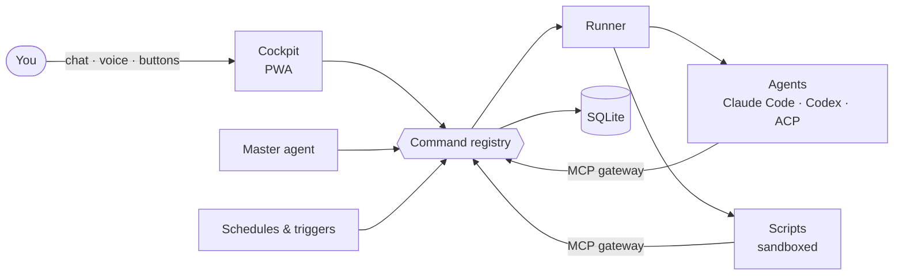

<div align="center">

# deck

**A personal control panel for AI agents.**
Give your models a desk, tools, data and limits — then just watch the work get done.


</div>

---

Most agent tools want you to babysit a chat. **deck** turns agents into workers: each line of your routine —
code, mail, research, markets, video — becomes a **module** with its own data, commands, schedule and screens. Agents do the work; you review, approve and steer from one cockpit on your laptop or phone.

It is a thin layer around smart models, not a framework that thinks for them. **The less of our own code, the
better:** what a model can do with a script or an agent stays out of the core. As models get smarter, deck gets
more capable without a release.

## What you get

- **One binary, one folder.** Go server + SQLite + embedded web client. No queues, no cloud, no ops.
- **Bring any agent.** Claude Code, Codex, and ACP agents (Goose) on any OpenAI-compatible model —
  each run isolated in its own sandbox and folder.
- **Modules are manifests, not code.** A JSON manifest declares collections, commands, scripts, triggers,
  screens and rights. Prompts and skills are documents the master agent can edit.
- **A master agent you talk to.** Chat or voice: it routes tasks to the right module, builds new modules from an
  interview, looks into failures and keeps a memory of what you told it.
- **You stay in charge.** Every action is a registry command with a class; widening rights, external calls and
  spending wait for your yes. Everything done without you lands in a feed with an undo.
- **Screens are data.** UI is server-driven ([A2UI](https://github.com/google/A2UI)) from a block catalog —
  tables, lists, forms, charts, media. What the catalog lacks, a model writes as an MCP App.
- **Works where you are.** Installable PWA, push notifications, share-to-deck, and your own tailnet over
  HTTPS with one flag.

## How it works



One door for everything: buttons, the master, schedules, scripts and agents all call the same commands through
the same gateway — so rights, limits and the journal are enforced in one place.

A module in a few lines:

```json
{
  "version": 6,
  "commands": [{
    "name": "digest", "title": "Morning digest", "class": "internal",
    "description": "Reads the sources and writes a short digest.",
    "input": {"type": "object"},
    "executor": {"type": "agent", "prompt": "Read my sources and write today's digest."}
  }],
  "triggers": [{"command": "digest", "cron": "0 9 * * *"}]
}
```

## Quick start

```bash
go build -o deck ./cmd/deck
DECK_HOME=~/.deck ./deck            # prints the URL with your access token
./deck -tailscale deck              # same, on your tailnet over HTTPS
```

You need Go 1.27 and at least one agent CLI on the machine (`claude` or `codex`). The web client is prebuilt into
the binary; rebuild it with `cd web && npm ci && npm run build`.

## Under the hood

Go · SQLite (sqlc, goose) · MCP · React + Vite + Mantine · `sandbox-exec` on macOS, bubblewrap on Linux ·
tsnet. Tested by scenario tests through the real gateway, plus real-browser runs with Playwright.

<div align="center">
<sub>A personal project, built in the open. Ideas and issues are welcome.</sub>
</div>
