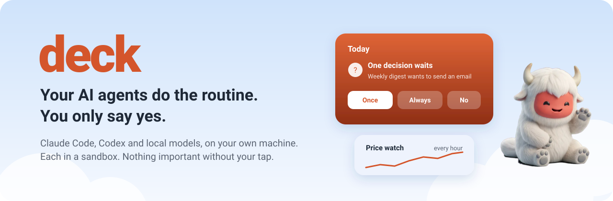
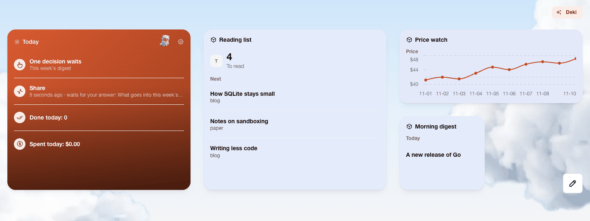
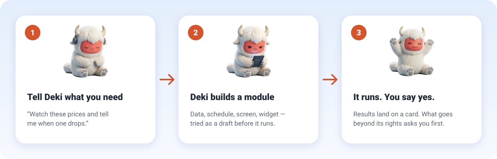
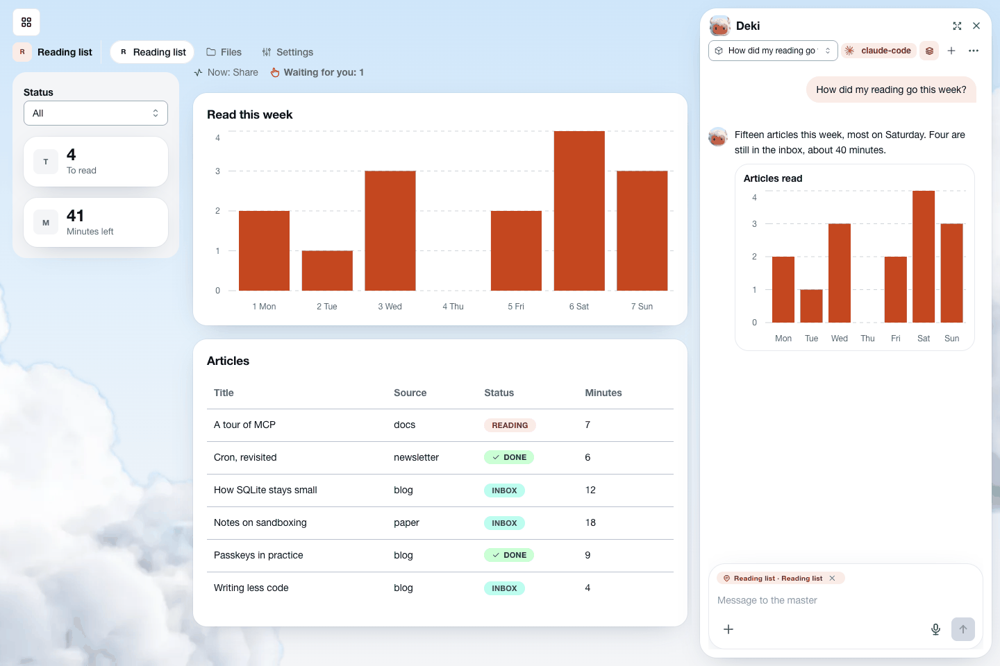
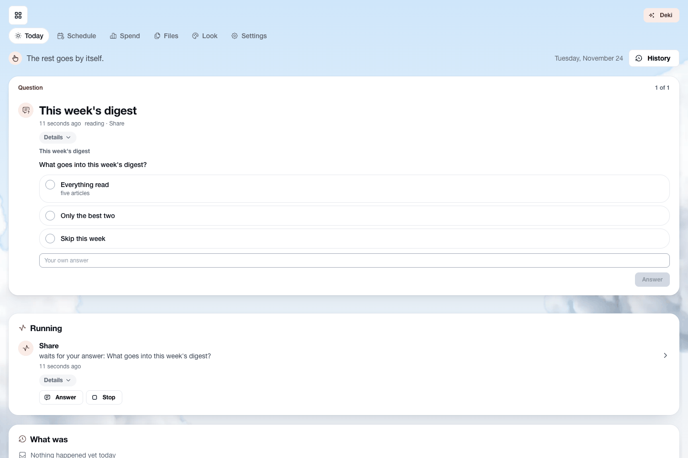
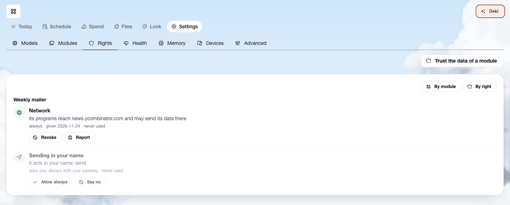
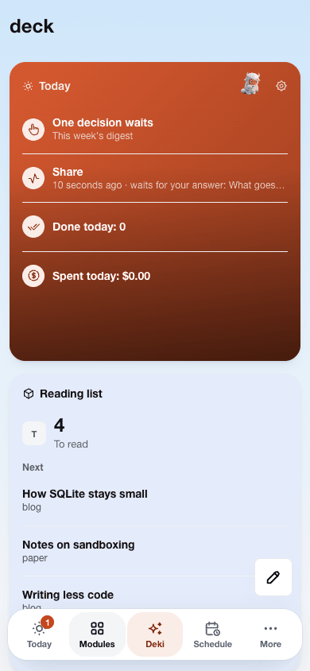

<div align="center">



**[Get started](#get-started)** · **[How it works](#how-it-works)** · **[You stay in charge](#you-stay-in-charge)** · **[Under the hood](docs/architecture.md)**

<br>



</div>

## What deck does for you

AI agents can already do real work. Sitting in a chat to start each run is the part nobody wants. deck takes a
routine off your hands — reading sources, watching prices, triaging pull requests, making short videos — and runs it
for you on a schedule. In the morning you open deck, see what was done, and answer the one or two things that need you.

<table>
<tr>
<td width="50%" valign="top">

### 💬 Ask in plain words
Tell Deki, deck's built-in assistant, what you need. It asks a few questions, builds a **module** — the data, the
schedule, the screen and a widget — tries it as a draft and hands it over. Later you just tell it what to change.

</td>
<td width="50%" valign="top">

### 🗂️ Everything on one screen
Your home is a grid of cards you arrange like a phone's. Each card is live: lists, numbers and charts update the
moment the data does. **Today** shows what waits for you, what runs, what was done and what the day cost.

</td>
</tr>
<tr>
<td width="50%" valign="top">

### 🛡️ Nothing important behind your back
Sending in your name, paying, a new website, another module's data — deck asks first, with one tap: once, always or
no. What agents changed on their own is listed, with an undo.

</td>
<td width="50%" valign="top">

### 🔑 Your models, your bill, your machine
Use your Claude or ChatGPT subscription, an API key, or a free local model. One program, one folder, no account, no
cloud of ours. **Spend** shows what each module costs.

</td>
</tr>
</table>

## How it works



Deki remembers what you told it and learns from what went wrong; **Settings → Memory** shows what it keeps, and you
can edit or delete any of it. A module is plain data — settings, prompts and small Python scripts — so you can export
it as a `.zip` (without your data or secrets) and share it.

## You stay in charge

- **Each module says what it may do, and why.** Before you turn one on, you see the rights it asks for: the network,
  a subscription login, your data, files, money, sending in your name, other modules.
- **New things ask first.** Turning a module on gives it what stays near it: its folders, its own services, the sites
  its programs name. The rest asks you the first time: once, for this work, always, or no. The question says which
  module wants what, and why. Pressing a button on a module's screen is your yes to what that button does.
- **Outside text gets a second look.** An agent that has read text from outside deck (the web, an import, a file) and
  holds a login or your data asks before it sends, pays, calls another module or reaches a new site — even where you
  said "always".
- **Take it back in one tap.** **Settings → Rights** lists every answer you gave, with a revoke and a report of what
  each module did. **Done without you** shows each run's changes, with an undo.
- **Every program runs in a box.** Scripts and agents see only their own folders and reach only the sites their
  rights name — and a site a module may read is a site it may send to. Clicking and submitting in the browser waits
  for your consent. Your API keys stay inside deck; a module reads only its own secrets.

> [!NOTE]
> A module you give a subscription login (Claude Code, Codex) runs an agent that can read that login. Give it only to
> modules you trust.

More in [Rights, requests and trust](docs/architecture.md#rights-requests-and-trust).

## A look inside

<table>
<tr>
<td width="50%"><br><sub><b>Deki beside a module.</b>
The chat sees the screen; a reply can carry a chart, a table, a form or options to pick.</sub></td>
<td width="50%"><br><sub><b>Today.</b>
What waits for you comes first, one at a time, answered right there.</sub></td>
</tr>
<tr>
<td width="50%"><br><sub><b>Rights.</b>
What each module may do and since when, revoked in one tap.</sub></td>
<td width="50%" align="center"><br><sub><b>On your phone.</b>
Add deck to the home screen: pushes, and share a link or a file into a module.</sub></td>
</tr>
</table>

## Get started

You need [Docker](https://docs.docker.com/engine/install/): on a Mac, [OrbStack](https://orbstack.dev) or Docker
Desktop; on Linux, Docker Engine with compose and your user in the group `docker`
([how](https://docs.docker.com/engine/install/linux-postinstall/)); Windows with WSL 2 is not tried yet. Then, as your
user (not with `sudo`):

```bash
curl -fsSL https://raw.githubusercontent.com/teaarte/deck/master/install.sh | sh
```

1. **Open the link it prints.** Your browser makes a passkey — no password, no account. Open deck at
   <http://deck.localhost:7700> on the same machine.
2. **Connect a model.** Settings → Models: sign in to Claude or ChatGPT, or add an API key (OpenRouter, Groq, NVIDIA…).
3. **Tell Deki what to do.** Describe a routine in the chat, or take the starter module it offers.

**On a server or from your phone** deck needs https — your domain or Tailscale. On a server, set that up
[before you pair](docs/install.md#on-a-server): the `deck.localhost` link opens only on the machine deck runs on.
Everything else — time zone, updates, Windows: [docs/install.md](docs/install.md). To update, run the same line again.

## For engineers

One Go binary with SQLite and the React client inside; every button, schedule, script and agent calls the same
commands through one entry. Each agent gets its own MCP server of deck; Claude Code, Codex and any ACP agent (such as
Goose on a local model) sit behind one interface, and a refused or silent turn goes to the next model. Programs run in
bubblewrap with one way out through deck's proxy. Screens are JSON rendered as [A2UI](https://github.com/google/A2UI).
About 1,400 scenario tests on a real SQLite, and the same against real CLIs, a local model and a browser behind flags.
The full picture: [docs/architecture.md](docs/architecture.md).

## Status

A personal project in daily use by its author, on a home server: one owner per deck. It changes fast. The latest
release is [v0.3.2](https://github.com/teaarte/deck/releases/latest).

## License

[PolyForm Noncommercial 1.0.0](LICENSE.md): free to read, run, change and share for any noncommercial purpose.
Commercial use needs a separate license from the author.
