<div align="center">

# deck

### Your AI agents do the routine. You only say yes.

A personal control panel that runs Claude Code, Codex and local models on your recurring work —<br>
on your own machine, in a sandbox, with every outbound step waiting for your one tap.


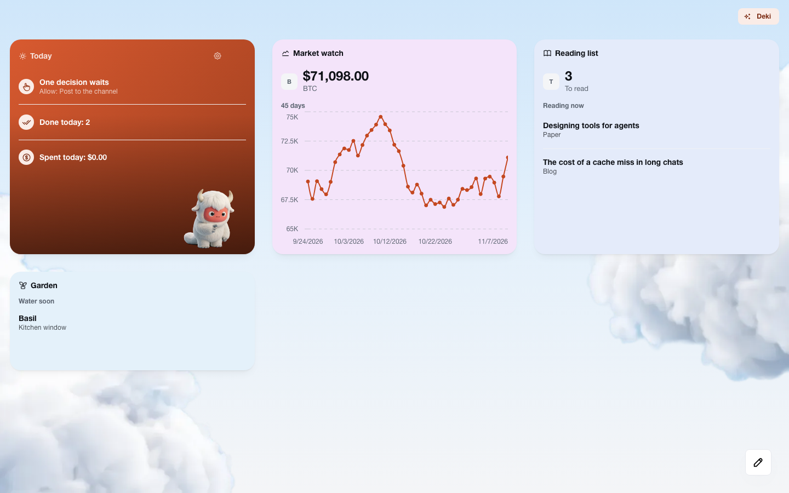

</div>

## Why deck

Coding agents are good enough to do real work. Sitting in a chat to start each run is not. deck turns a routine —
reading sources, watching prices, triaging pull requests, making short videos — into a **module** that runs on a
schedule, keeps its data and shows the result on a card. You open deck in the morning, see what was done, and
answer the one or two things that need you.

- **Ask for a module in words.** Deki, the built-in master agent, interviews you for a minute, builds the module
  (data, commands, schedule, screens, widgets), tries it as a draft and hands it over. Later you just tell it what
  to change.
- **Nothing important happens behind your back.** Anything that leaves the machine, spends money or widens a
  module's rights waits for your yes, and a button you press already is that yes. What agents changed on their own
  is one line per run under **Done without you**, with an undo.
- **Your models, your bill.** Subscriptions (Claude Code, Codex) or any model on OpenRouter, Google, Anthropic,
  Groq, a local server or Ollama. Pick the model of each command in its row, with fallbacks. **Spend** shows what
  every module costs.
- **Yours.** One program, one folder, no account, no cloud. Keys stay in deck: each module reads only its own secrets,
  and no module reads the keys of model connections.

## Tiles and live widgets

The home screen is a grid of cards you place and resize freely, any width by any height, separately for each
device. Each module card is a **live widget**: a tiny screen of the module's own data that updates the moment the
data changes, with no polling.

- A module declares up to eight widget views in its manifest, each for a least size (`1x1`, `2x1`, `3x2`, …) and
  made of up to four `stat`, `list` and `chart` blocks. The card shows the largest view that fits, on a phone too
  (two cells across), and fills it from the top: a list shows as many lines as there is room for, a chart grows
  over the room left, and a block the card has no room for is named in its corner (`+1`). Its buttons work as on a
  screen.
- Resize a card to a size the module has no view for, press **Draw a widget**, and Deki designs one on the model you
  assigned to that work. The result is an ordinary manifest edit you can undo.
- **Today** is deck's own widget: what waits for you, what failed, what runs, what was done, what the day cost and
  what runs next.
- A card without widgets shows its cover, which Deki can also draw.

## Deki, the master agent

Deki lives in a side chat next to any screen and sees what you are looking at, so "this" and "here" just work.

- **Live work.** One line says what it is doing right now (reading a document, calling `dec.add`, running a
  command) with a timer, the model and Stop; a tap opens its steps and the log in place.
- **Paste and drop.** A screenshot or a file goes into a message straight from the clipboard or by dragging it on
  the field. Hover a message (tap it on a phone) for its model, cost and the time it was written.
- **Questions as cards.** One at a time, each option with what it means, single or multiple choice, or your own
  answer.
- **Long work in the background.** A rebuild with renders and self-checks goes to a process of its own; the chat
  stays free.
- **Memory and a daily review.** It remembers what you told it and looks over the day on its own.

## Under the hood

For those who want to know how it holds together; the full picture is in
[docs/architecture.md](docs/architecture.md).

- **One binary, one door.** About 70k lines of Go with SQLite and the React client embedded. Buttons, the API,
  schedules, scripts and agents all call the same commands through one registry, so rights, confirmations, the
  journal and the undo are enforced in exactly one place.
- **MCP-native.** Every agent process gets its own deck MCP server: the commands it may call as tools, questions and
  confirmations to the owner, nothing else. Scripts get an HTTP entry with a per-run token.
- **Sandboxed, with one way out.** Every program of a module — a script, an MCP server, Claude Code, Codex, an ACP
  agent — runs in a box of its own (bubblewrap on Linux) that sees only its folders and reaches only the hosts its
  rights name, through deck's proxy: a name resolves once, only public addresses are dialed. The proxy sees the host,
  not the method: a host a module may read is a host its programs may also send to, so grant `domains.read` as
  network; clicking, typing and submitting in the browser (`domains.act`) is what waits for your consent. A service on
  your machine or network is named by its IP:port, never by a name (Codex on a local model too: its `base_url` by
  IP:port). Model keys live in the
  proxy, never in a module. The login of Claude Code or Codex is one for all projects, and the agent in a box can read
  it, as the CLI does; another project's data it cannot. On a Mac deck runs in its container; a node on a Mac (and deck
  without Docker there) runs scripts, MCP servers and ACP agents under `sandbox-exec`, and Claude Code and Codex
  outside it, as the owner's.
- **Screens are data.** Screens and widgets are JSON resolved on the server into [A2UI](https://github.com/google/A2UI)
  messages from a catalog of blocks (tables, boards, cards, forms, charts, media, a file manager, tabs, dialogs,
  side panels). Each read declares its topics; a committed write publishes the topic of its table, and the client
  refreshes over SSE only what changed. Anything the catalog lacks is an
  [MCP App](https://github.com/modelcontextprotocol/ext-apps) in a sandboxed frame on a second origin.
- **Modules are not code in deck.** A manifest, prompts, skills and small scripts. Export to a `.zip` without your
  data or secrets; import as a draft that shows what it needs and what it may do before you enable it.
- **Any agent behind one interface.** The Claude Code CLI, the Codex app-server (its protocol generated from the
  installed CLI) and any ACP agent such as Goose on a local model. A refused or silent turn goes to the next model
  of the assignment; a CLI that is not installed is simply off.
- **Tested end to end.** About 1,000 scenario tests through the real registry and gateway on a real SQLite with a fake
  provider; behind flags, the same against the real Claude Code, Codex, a local model and a real browser at desktop
  and phone sizes. Provider adapters are contract-tested on recorded streams.

## A look inside

<table>
<tr>
<td width="50%">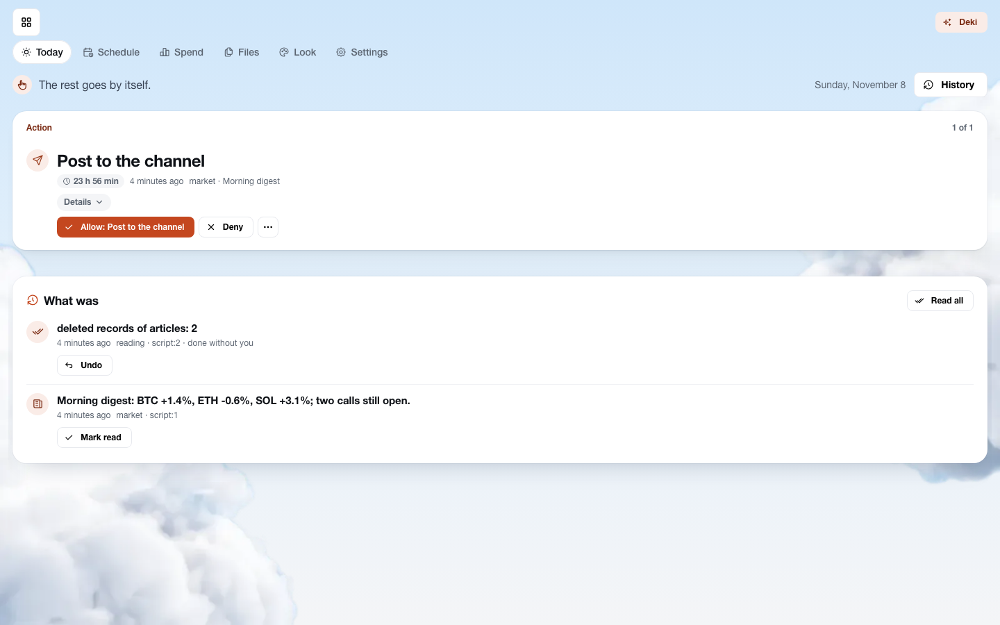<br><sub><b>Today.</b>
One decision waits; a run's deletions sit under "done without you" with an undo.</sub></td>
<td width="50%">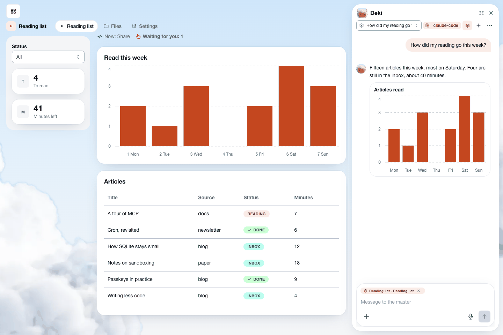<br><sub><b>Deki beside a module.</b>
The chat sees the screen and offers its commands.</sub></td>
</tr>
<tr>
<td width="50%">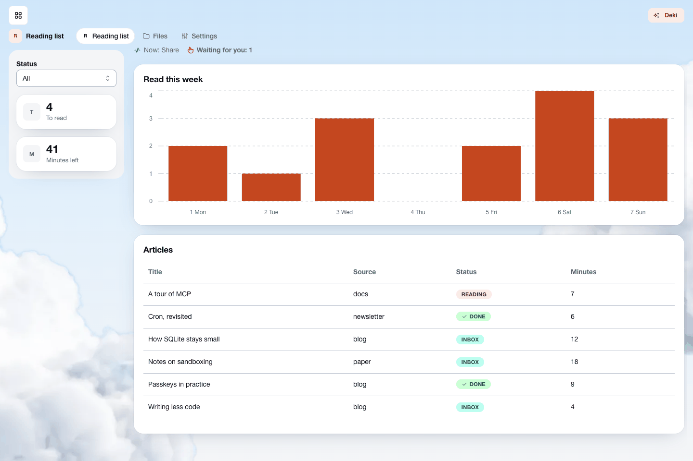<br><sub><b>A module screen.</b>
Side panel with a filter and stats, a chart and a table, all from the manifest.</sub></td>
<td width="50%">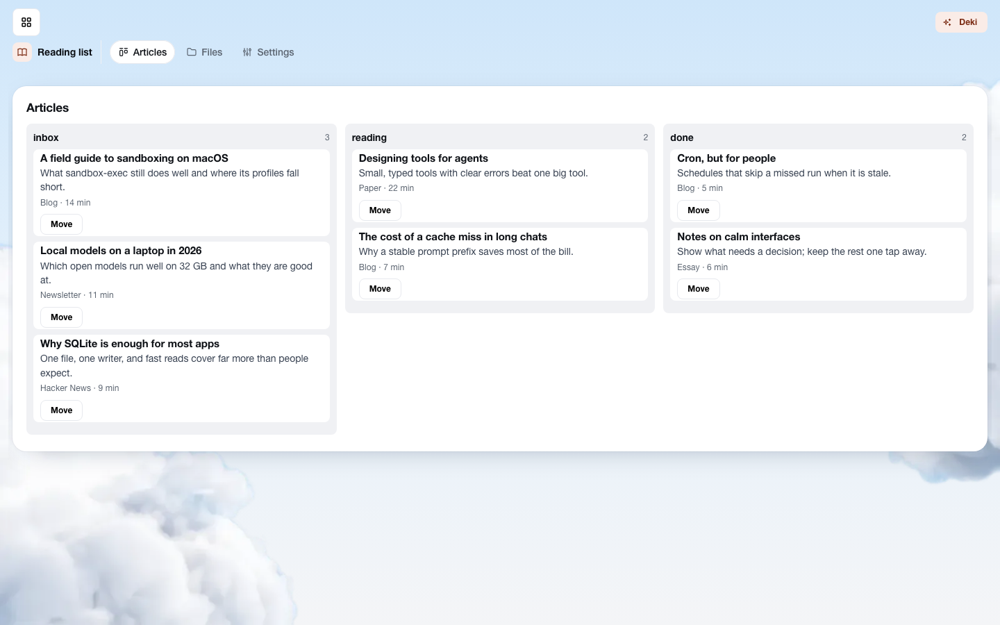<br><sub><b>A board.</b>
Records in lanes by their status; dragging a card runs the module's command.</sub></td>
</tr>
<tr>
<td width="50%">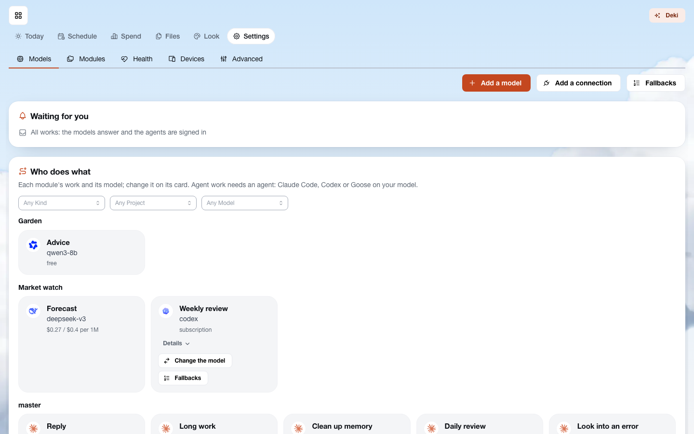<br><sub><b>Models.</b>
The model of each command picked in its row, with price and fallbacks.</sub></td>
<td width="50%">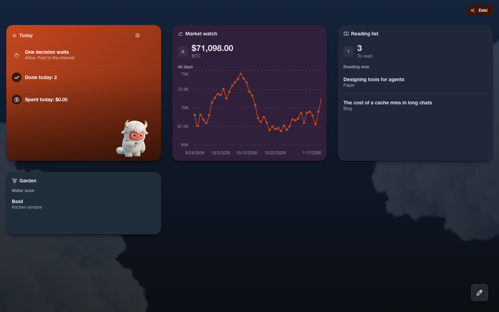<br><sub><b>Dark scheme.</b>
The same tiles; the theme follows the system or your choice.</sub></td>
</tr>
<tr>
<td width="50%" align="center">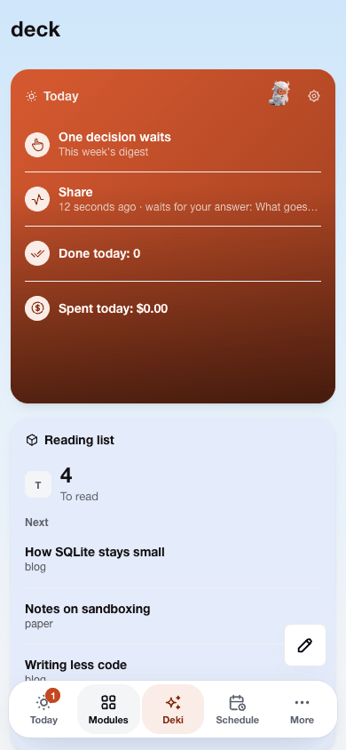
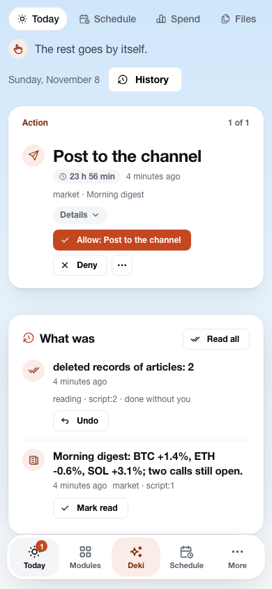<br><sub><b>On a phone.</b>
Tiles and Today, with a tab bar for the thumb.</sub></td>
<td width="50%">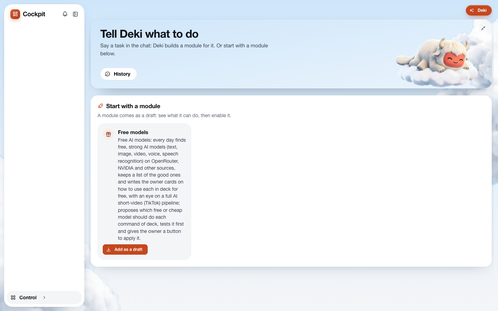<br><sub><b>First run.</b>
Tell Deki what you need, or add a starter module as a draft.</sub></td>
</tr>
<tr>
<td width="50%">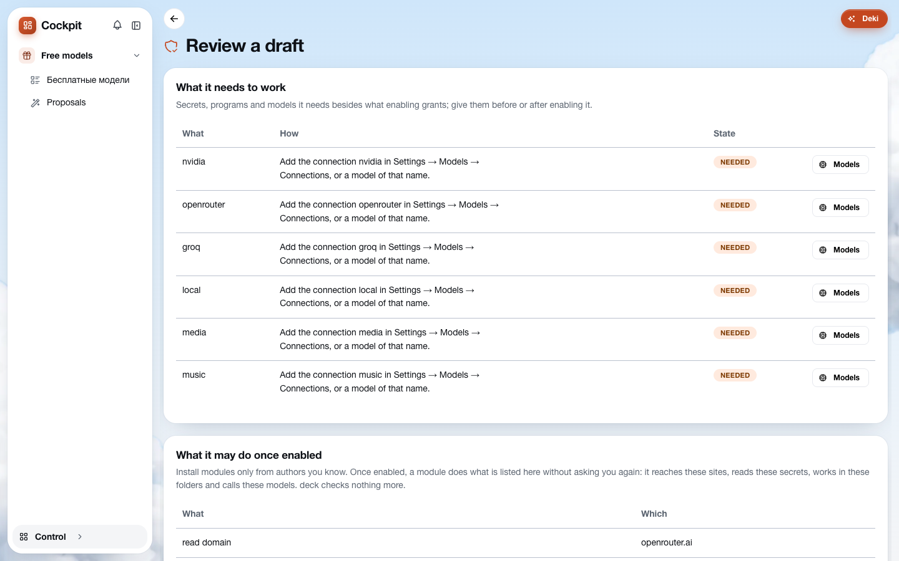<br><sub><b>A draft before enabling.</b>
What the module needs and what it may do once enabled.</sub></td>
<td width="50%"></td>
</tr>
</table>

## Install

One way for every machine: Docker with compose and deck's image, with Claude Code, Codex, uv and a browser inside.
On Linux, Docker Engine; on a Mac, [OrbStack](https://orbstack.dev) or Docker Desktop; on Windows, Docker Desktop
(not tried yet: GitHub's Windows runners do not run Linux containers, so no test covers it).

```bash
curl -fsSL https://raw.githubusercontent.com/teaarte/deck/master/install.sh | sh
```

It puts deck in `~/deck` (`DECK_DIR` for another folder), loads the AppArmor profile on Ubuntu and Debian (`sudo` asks
once), starts deck and prints a link that pairs your device; run again, the same line updates deck. By hand:

```bash
mkdir deck && cd deck
for f in compose.yaml seccomp.json deck-box.apparmor move-to-docker.sh; do curl -fsSLO https://raw.githubusercontent.com/teaarte/deck/master/$f; done
# Ubuntu and Debian, once: the AppArmor profile the container runs under
sudo install -m644 deck-box.apparmor /etc/apparmor.d/deck-box && sudo apparmor_parser -r /etc/apparmor.d/deck-box
docker compose up -d
docker compose exec deck deck pair        # a link that pairs a device
```

On Windows run the commands by hand in WSL or PowerShell (`curl.exe`), skipping the AppArmor step.

deck starts with Docker and after a restart of the machine (`restart: unless-stopped`); its data and the logins of
the agents stay in the volume `deck`. Open the link, then sign in to the agents in Settings → Models → **Sign in**:
Codex shows a link and a code, Claude Code a link whose page gives the code to enter. The models of the machine
itself (Ollama, whisper and other local servers) and its folders reach deck in the container through a [node](#node).
To update: `docker compose pull && docker compose up -d`; when a release is out, Settings → Advanced and the feed say
so.

**Open deck.**

- **On this machine** — <http://deck.localhost:7700>. Browsers take `deck.localhost` to this machine and treat it as
  secure, so a passkey works there without https; its cookie goes to no other server of the machine. Tried in
  Chromium (Chrome, Edge) and WebKit (Safari); Firefox is not tried yet.
- **From your phone and other devices** — over https only. Either Tailscale: put `DECK_TAILSCALE=deck` in `.env`,
  and deck joins your tailnet itself as `https://deck.<tailnet>.ts.net` (the sign-in link is in its log); or install
  Tailscale on the machine and run `tailscale serve --bg 7700` and `tailscale serve --bg --https=8443 7701`, with
  `DECK_DOMAIN=<machine>.<tailnet>.ts.net` in `.env`. Tailscale is needed on the device you open deck from too. Or
  your own domain, below.
- **As an app window** — in Safari, File → Add to Dock; in Chrome or Edge, Install deck from the address bar. On a
  phone, add deck to the home screen: pushes and sharing a link or a file into a module work as in a native app.

**Signing in.** A device pairs once by a link of `deck pair` (or of Settings → Devices on a device signed in, with its
QR code for a phone) and makes a passkey there; the link works once, within ten minutes, and the passkey signs the
device in from then on. A passkey synced to your other devices (iCloud Keychain, Google Password Manager) signs each
browser in as a device of its own. Settings → Devices lists every device and passkey: revoking a device signs out that
browser alone, revoking a passkey signs out every browser that used it. On `http://localhost` deck
gives no cookie: the browser would send it to every server on localhost, whatever its port; deck sends a page opened
there to `deck.localhost`. A cookie of `deck.localhost` goes to that name on any port too, so open no link to
`deck.localhost` with another port.

**A server with a domain.** On a Linux server (amd64 or arm64) with a domain name pointing at it and ports 80, 443 and
8443 open, put two lines in `.env` before `docker compose up -d`; Caddy in the same compose then gets the HTTPS
certificate and serves deck at that name, with no Tailscale:

```bash
printf 'DECK_DOMAIN=deck.example.com\nCOMPOSE_PROFILES=domain\n' > .env
```

Add `DECK_TAILSCALE=deck` to `.env` to also reach deck on your tailnet from deck's own node. A server set up before
Caddy came under the profile has only `DECK_DOMAIN` in `.env`: add `COMPOSE_PROFILES=domain` when you download the new
`compose.yaml`, or Caddy no longer starts (deck says so in its log).

**What the container needs.** Every program of a module runs in a box of its own inside the container, built by
bubblewrap as on any Linux. For that `compose.yaml` gives the container three lines, and nothing else is loosened:
`seccomp=./seccomp.json` (Docker's default profile with `clone`, `unshare`, `mount`, `umount2` and `pivot_root`
allowed), `systempaths=unconfined` (so a box mounts its own `/proc`) and `apparmor=deck-box` (Docker's
`docker-default` with `mount` and `pivot_root` allowed). A host without AppArmor ignores the last line; on a host with
AppArmor where the profile is not loaded, Docker does not start the container and says the profile is not found.
Without these lines deck starts no foreign program, and Settings → Health says which line is missing. Tried on Ubuntu 22.04 and
24.04 with Docker, rootless Docker and OrbStack; Docker Desktop and SELinux hosts (Fedora, RHEL) are not tried yet.

**Trying Docker Desktop on Windows.** Install Docker Desktop with the WSL 2 backend, download the three files into a
folder and run `docker compose up -d` there (skip the AppArmor step). deck works when Settings → Health shows the box
`ok`, a script of a starter module runs, and the link of `docker compose logs deck` pairs at http://deck.localhost:7700
in Edge or Chrome.

**Updating from v0.1.** v0.1 ran agents as a user `agent` with their logins in a volume `agents`. Update the image
first, with the old `compose.yaml`: on its first start the new image copies the logins into deck's volume. deck then
starts no foreign program and says why; download the three files above, load the profile and run
`docker compose up -d` again. The volume `deck_agents` is no longer used: `docker volume rm deck_agents`. A new
`compose.yaml` before the new image leaves the logins behind, and the agents need to sign in again.

**Moving from deck without Docker.** A deck that ran as a binary (`~/.deck2`) moves into the volume whole: its data,
devices and passkeys, secrets, the homes of the CLIs, and its tailnet's state, so it keeps its address there.

1. Stop that deck and keep a copy of its folder: `cp -a ~/.deck2 ~/.deck2-backup-$(date +%F)`.
2. Beside `compose.yaml`, with `DECK_TAILSCALE=<its name on the tailnet>` in `.env` if it was on one, run
   `sh move-to-docker.sh ~/.deck2`. Run again, it brings the folder over anew.
3. `docker compose up -d`, then sign in at <http://deck.localhost:7700> and on the tailnet with the same devices.
4. deck in the container sees no folder and no model of the machine: pair a node on it (below), set **Node** of the
   connections at `127.0.0.1`, and in each module's settings, Access, remove the folders of deck's machine and add them
   again on the node. The CLIs of the image sign in once in Settings → Models, or the node's agents take the turns
   (`claude-code@Mac`).

To go back, `docker compose down` and start the old binary on `~/.deck2`, which the move leaves as it was.

## Node

deck in a container — on a server, or on a Mac in OrbStack or Docker Desktop — does not reach the models of a machine
that listen on its own `127.0.0.1` (whisper, servers of pictures, music and speech, Ollama, SearXNG), nor a Mac's
GPU. A **node** serves them: the same `deck` binary on that machine, outside Docker, holds one connection out to deck
and carries deck's calls to its loopback. It needs no Tailscale and opens no port; it reaches nothing of its network
but its own loopback, and its key opens nothing of deck but that connection.

1. On deck's machine run `deck pair --node --name Mac` (in Docker: `docker compose exec deck deck pair --node --name
   Mac`), or pair a node in Settings → Devices. It prints a command with a code that works once, within ten minutes.
2. On the node's machine, with the binary of [the release](https://github.com/teaarte/deck/releases) for it, run that
   command: `deck -join https://deck.example.com <code> --install` (for deck on the same Mac,
   `deck -join http://127.0.0.1:7700 <code> --install`), with `--allow` and what deck may use there: the ports of its
   models and the agents, such as `--allow 8178,8190,claude-code`. The node keeps that list itself, in
   `~/.deck2-node/state/node/allowed` (one edit there holds at once); deck never widens it, and a call to a port not on
   it is refused, with a row in Settings → Health of what to add. It pairs, keeps the key in
   `~/.deck2-node/state/node/joined.json`
   (readable by you alone) and installs a service that starts the node when you sign in and keeps it connected: a
   LaunchAgent `deck-node` on macOS (`~/Library/LaunchAgents`), a unit of systemd of your user on Linux
   (`~/.config/systemd/user/deck-node.service`; on a server without a session of yours, `loginctl enable-linger`).
   Its log is `~/.deck2-node/state/node/node.log`; the node's folder is apart from that of a deck on the same machine
   (a node joined before into `~/.deck2` moves its key there with `deck -join <address> --install --allow …` once). Without `--install` the node runs in the terminal until Ctrl-C.
   `deck -join --uninstall` stops and removes the service; revoking the node in Settings → Devices ends its connection
   at once and refuses its key.
3. In Settings → Models → Connections set **Node** of each connection the node's machine serves, its address as on
   that machine, such as `http://127.0.0.1:8178` for whisper.

While the node is off, a call of its model goes at once to the next model of its fallbacks; Settings → Health has a row
of each node: online or not since when, what it serves, and the command to run on its machine. A big answer of a
model of a node, a picture or a sound, comes to deck as it streams and is kept there; the row `disk` of Health warns
before deck's disk fills.

### Agents on a node

A node runs the agents of deck on its own machine and sign-in, such as Claude Code on the owner's subscription of a
Mac while deck lives on a server. Allow them on the node (`--allow claude-code,codex`, or an ACP agent such as
`goose`); deck then offers `claude-code@Mac` (and each model of the CLI `@Mac`) in Settings → Models while the node is
online, and an assignment picks it as any other agent, with fallbacks. Sign the CLI of the node in from deck: the
sign-in of `claude-code@Mac` runs on the node, its link comes to deck. A turn on a node works in the node's copy of the
turn's folders (up to 2 GB), reaches deck's tools, questions and the model of an ACP agent through deck by the node's
key, and brings the files it changed back to deck at its end; a turn in a project folder runs on the machine of that
folder (below). On a Mac node the CLIs run outside a box, so an agent allowed on a Mac node acts as its user: allow it
only on a machine you trust deck with. If the node goes away in the middle of a turn, the turn waits for it three minutes (a row in the feed
says so), goes on in its session if the node comes back, and otherwise goes to the next agent of the assignment.

### Folders on a node

A project folder can be on a node's machine, such as a repository or a folder of data deck in a container does not
see. Allow the folder on the node with its path, as `--allow 8178,claude-code,~/code/repo,~/lab/data` (a path begins
with `/` or `~`, and allows what is inside it; the node's own folder and `~/.deck2` are never allowed), then add it to
the module in its settings, Access, naming the node. deck asks the node whether the folder is there and allowed:
a folder not on its list is refused with what to add, and once the owner takes one off the list later, the turn or
script that needs it is refused and Settings → Health says the same in the row of the node.

- An agent command that works in a folder of a node runs on the agent of that node (`claude-code@Mac` for an
  assignment of `claude-code`), in the folder itself; what it commits or pushes stays in that repository. A git
  repository may have a clone on each machine, deck's too, under one name: the turn goes where a clone is, an online
  one first. Any other folder is on one machine.
- The scripts of a module whose folders are on a node run on that node, in its box, reading them; scripts of a module
  whose folders are on deck's machine, or that has none, run on deck. No field of the manifest says where: the folders
  do.
- The data of the module, its records and files stay on deck: a script or a turn on a node gets a copy of its run
  folder and of the module's data, and what it changed comes back to deck at its end (Health `disk` warns before deck's
  disk fills). So runs of one command of a node's scripts take turns there, even with `"runs": "many"`; a file that
  changed on deck meanwhile, by another run or by you, stays as it is on deck, and the run's log names the changes of
  the run that did not come back.
- Removing a folder in Access takes it from the one machine of its row; revoking a node in Settings → Devices takes its
  folders from every module.
- While the node is off, a turn or script of its folder waits for it a few minutes (the feed and the row of the node
  say so), runs once it is back, and otherwise a turn goes to the next agent and a script fails saying the node did not
  come back.

## Without Docker

For developing deck: macOS or Linux, Go 1.27, and at least one agent CLI (`claude` or `codex`) or an ACP agent on a
local model. Node is needed only to rebuild the web client, which is embedded in the binary.

```bash
go build -o deck ./cmd/deck             # add -tags tailnet to serve deck on your Tailscale network
./deck                                  # prints http://deck.localhost:7700 and, until a device pairs, the link that pairs one
./deck pair                             # a link that pairs one more device, whether deck runs or not
DECK_HOME=/tmp/deckhome ./deck          # another data folder
./deck -addr 127.0.0.1:7700             # the listen address (default); the next port serves custom blocks
./deck -tailscale deck                  # with the tag: join your tailnet as "deck" over HTTPS
```

Releases are on [GitHub](https://github.com/teaarte/deck/releases): `deck-<os>-<arch>` (`-tailnet` with the tailnet)
and the image `ghcr.io/teaarte/deck`.

**Updating.** A released binary looks for a new release once a day (deck in Docker says so too, and updates by
`docker compose pull`). When one is out, Settings → Advanced and a note in
the feed show an **Update** button, which only the owner can press. deck downloads the build it was made from and
checks it against `release.json`, whose ed25519 signature it checks with the key built into it. It takes a snapshot, puts the
new binary in place and restarts; the agents go on in their sessions. If the new version never gets as far as
serving, the next start goes back to the old one. If the signature or a sha256 does not match, deck
stays as it is. A deck built from source
calls itself `dev`, offers no updates, and is updated with `git pull` and `go build`. On start, deck migrates its
database and the stored manifests.

## Status

deck is a personal project in daily use by its author, on a Mac in OrbStack with a node for the Mac's models and
folders: one owner per deck, the same image on a server and on one computer. It changes fast; the database and
manifests are migrated on start.

## License

[PolyForm Noncommercial 1.0.0](LICENSE.md): free to read, run, change and share for any noncommercial purpose.
Commercial use needs a separate license from the author.
