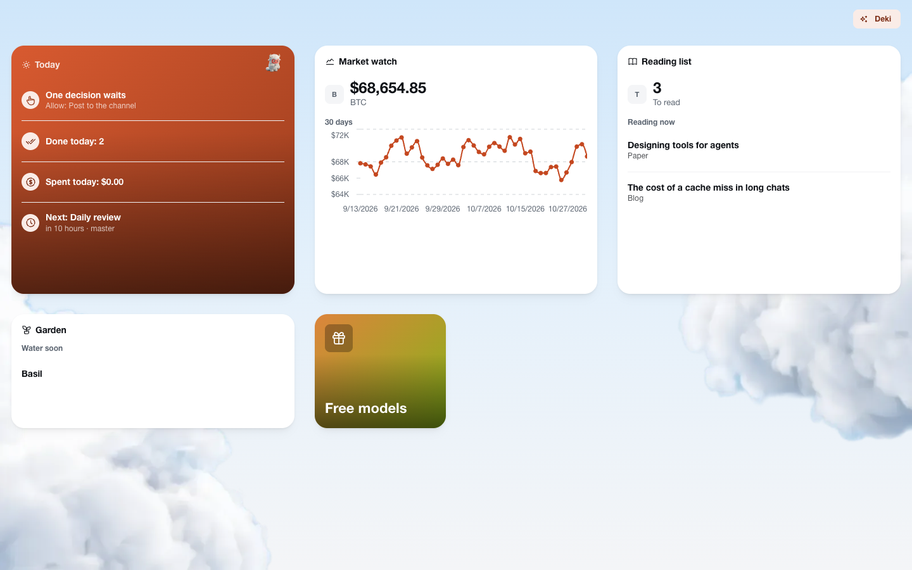
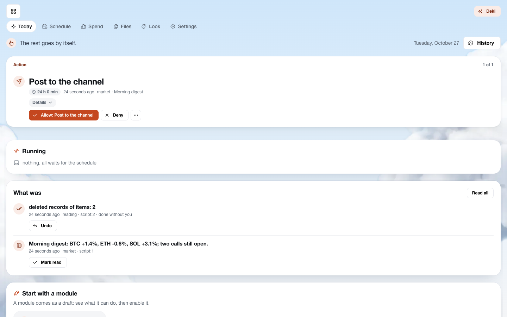
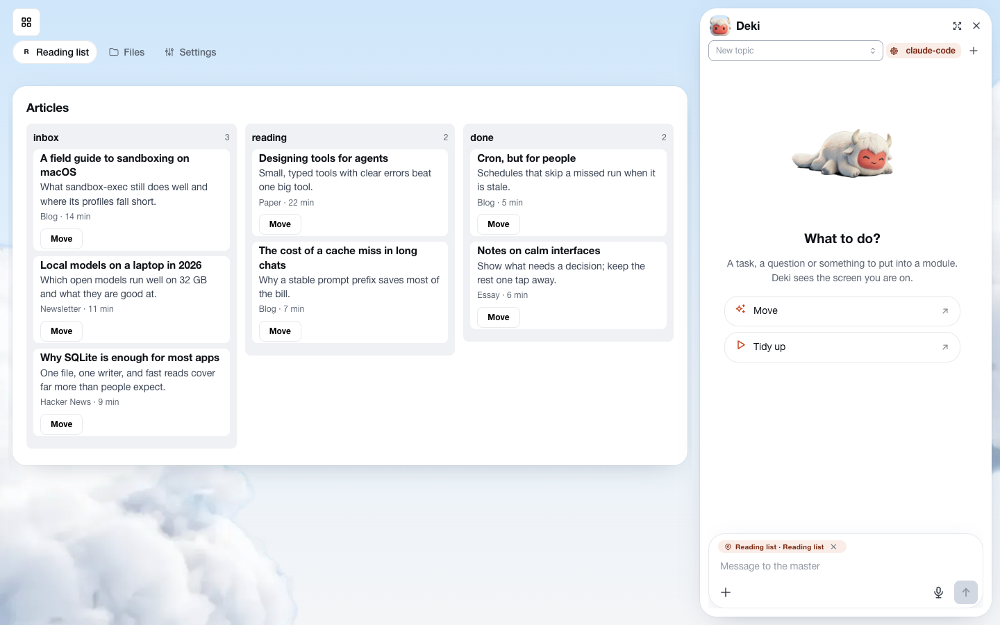
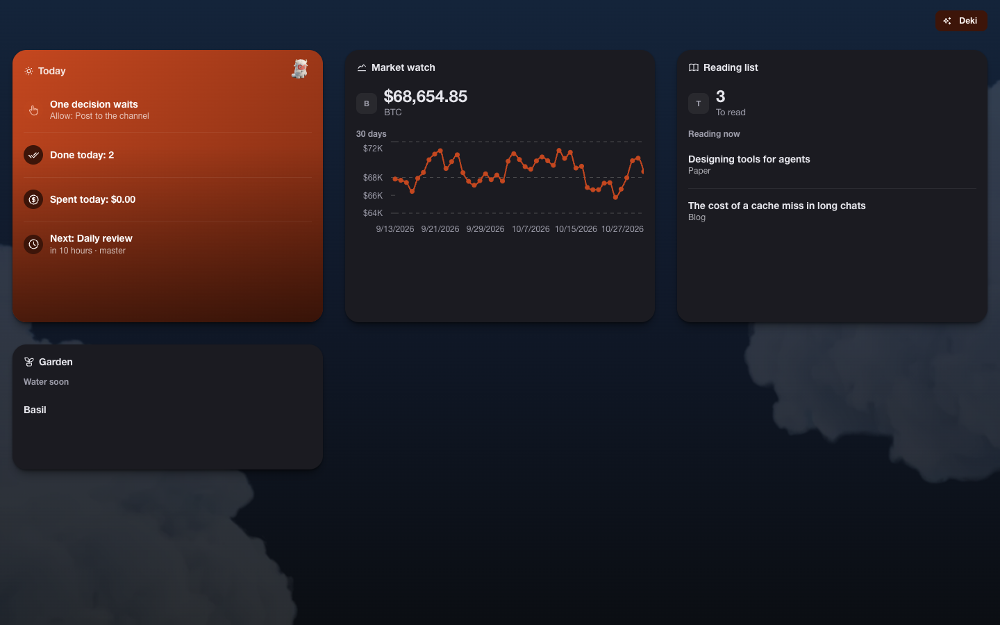
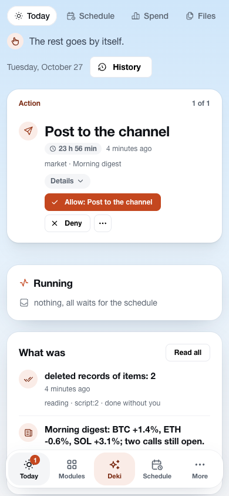

<div align="center">

# deck

### Your AI agents do the routine. You only say yes.

A personal control panel that runs Claude Code, Codex and local models on your recurring work —<br>
on your own machine, in a sandbox, with every outbound step waiting for your one tap.




</div>

## Why deck

Coding agents are good enough to do real work. Sitting in a chat to start each run is not. deck turns a routine —
reading sources, watching prices, triaging pull requests, making short videos — into a **module** that runs on a
schedule, keeps its data and shows the result on a card. You open deck in the morning, see what was done, and
answer the one or two things that need you.

- **Ask for a module in words.** Deki, the built-in master agent, interviews you for a minute, builds the module
  (data, commands, schedule, screens, widgets), tries it as a draft and hands it over. Later you just tell it what
  to change.
- **Nothing important happens behind your back.** Anything that leaves the machine, spends money or widens a
  module's rights waits for your yes, and a button you press already is that yes. What agents changed on their own
  is one line per run under **Done without you**, with an undo.
- **Your models, your bill.** Subscriptions (Claude Code, Codex) or any model on OpenRouter, Google, Anthropic,
  Groq, a local server or Ollama. Pick the model of each command in its row, with fallbacks. **Spend** shows what
  every module costs.
- **Yours.** One program, one folder, no account, no cloud. Keys stay in deck's secret store; agents and scripts
  never see them.

## Tiles and live widgets

The home screen is a grid of cards you place and resize freely, any width by any height, separately for each
device. Each module card is a **live widget**: a tiny screen of the module's own data that updates the moment the
data changes, with no polling.

- A module declares up to eight widget views in its manifest, each for a least size (`1x1`, `2x1`, `3x2`, …) and
  made of up to four `stat`, `list` and `chart` blocks. The card shows the largest view that fits and fills it
  from the top: a list shows as many lines as there is room for, a chart gets wider. Its buttons work as on a screen.
- Resize a card to a size the module has no view for, press **Draw a widget**, and Deki designs one on the model you
  assigned to that work. The result is an ordinary manifest edit you can undo.
- **Today** is deck's own widget: what waits for you, what failed, what runs, what was done, what the day cost and
  what runs next.
- A card without widgets shows its cover, which Deki can also draw.

## Deki, the master agent

Deki lives in a side chat next to any screen and sees what you are looking at, so "this" and "here" just work.

- **Live work.** A status line says what it is doing right now (reading a document, calling `dec.add`, running a
  command), and the full log is one tap away.
- **Questions as cards.** One at a time, each option with what it means, single or multiple choice, or your own
  answer.
- **Long work in the background.** A rebuild with renders and self-checks goes to a process of its own; the chat
  stays free.
- **Memory and a daily review.** It remembers what you told it and looks over the day on its own.

## Under the hood

For those who want to know how it holds together; the full picture is in
[docs/architecture.md](docs/architecture.md).

- **One binary, one door.** About 50k lines of Go with SQLite and the React client embedded. Buttons, the API,
  schedules, scripts and agents all call the same commands through one registry, so rights, confirmations, the
  journal and the undo are enforced in exactly one place.
- **MCP-native.** Every agent process gets its own deck MCP server: the commands it may call as tools, questions and
  confirmations to the owner, nothing else. Scripts get an HTTP entry with a per-run token.
- **Sandboxed, with one way out.** Scripts, MCP servers and ACP agents run under `sandbox-exec` (macOS) or bubblewrap
  (Linux). The only network path is deck's proxy: a name resolves once, only public addresses are dialed, only the
  module's declared domains are reachable. Model keys live in the proxy, never in a module.
- **Screens are data.** Screens and widgets are JSON resolved on the server into [A2UI](https://github.com/google/A2UI)
  messages from a catalog of blocks (tables, boards, cards, forms, charts, media, a file manager, tabs, dialogs,
  side panels). Each read declares its topics; a committed write publishes the topic of its table, and the client
  refreshes over SSE only what changed. Anything the catalog lacks is an
  [MCP App](https://github.com/modelcontextprotocol/ext-apps) in a sandboxed frame on a second origin.
- **Modules are not code in deck.** A manifest, prompts, skills and small scripts. Export to a `.zip` without your
  data or secrets; import as a draft that shows what it needs and what it may do before you enable it.
- **Any agent behind one interface.** The Claude Code CLI, the Codex app-server (its protocol generated from the
  installed CLI) and any ACP agent such as Goose on a local model. A refused or silent turn goes to the next model
  of the assignment; a CLI that is not installed is simply off.
- **Tested end to end.** About 900 scenario tests through the real registry and gateway on a real SQLite with a fake
  provider; behind flags, the same against the real Claude Code, Codex, a local model and a real browser at desktop
  and phone sizes. Provider adapters are contract-tested on recorded streams.

## A look inside

<table>
<tr>
<td width="50%"><br><sub><b>Today.</b>
One decision waits; a run's deletions sit under "done without you" with an undo.</sub></td>
<td width="50%"><br><sub><b>Deki beside a module.</b>
The chat sees the screen and offers its commands.</sub></td>
</tr>
<tr>
<td width="50%"><br><sub><b>A module screen.</b>
Side panel with a filter and stats, a chart and a table, all from the manifest.</sub></td>
<td width="50%"><br><sub><b>A board.</b>
Records in lanes by their status; dragging a card runs the module's command.</sub></td>
</tr>
<tr>
<td width="50%"><br><sub><b>Models.</b>
The model of each command picked in its row, with price and fallbacks.</sub></td>
<td width="50%"><br><sub><b>Dark scheme.</b>
The same tiles; the theme follows the system or your choice.</sub></td>
</tr>
<tr>
<td width="50%" align="center">
<br><sub><b>On a phone.</b>
Tiles and Today, with a tab bar for the thumb.</sub></td>
<td width="50%"><br><sub><b>First run.</b>
Tell Deki what you need, or add a starter module as a draft.</sub></td>
</tr>
<tr>
<td width="50%"><br><sub><b>A draft before enabling.</b>
What the module needs and what it may do once enabled.</sub></td>
<td width="50%"></td>
</tr>
</table>

## Install and run

macOS or Linux, Go 1.27, and at least one agent CLI (`claude` or `codex`) or an ACP agent on a local model. Node is
needed only to rebuild the web client, which is embedded in the binary.

```bash
go build -o deck ./cmd/deck             # add -tags tailnet to serve deck on your Tailscale network
./deck                                  # prints the address with the access token; data in ~/.deck2
DECK_HOME=/tmp/deckhome ./deck          # another data folder
./deck -addr 127.0.0.1:7700             # the listen address (default); the next port serves custom blocks
./deck -tailscale deck                  # with the tag: join your tailnet as "deck" over HTTPS
```

To update, replace the binary: on start deck migrates its database and the stored manifests.

- **Phone.** Open deck's address in Safari or Chrome, enter the token once and add it to the home screen. Pushes and
  sharing a link or a file into a module work as in a native app. Away from home, run deck with `-tailscale`.
- **Desktop app.** `desktop/build.sh` builds `deck.app` for macOS and an installer for Windows, where deck runs in
  its own WSL2 distribution (not yet tried on a real Windows machine). The launcher lives in the tray and can start
  at login.

## Status

deck is a personal project in daily use by its author: one owner per deck, macOS first, Linux tested in docker.
It changes fast; the database and manifests are migrated on start.

## License

[PolyForm Noncommercial 1.0.0](LICENSE.md): free to read, run, change and share for any noncommercial purpose.
Commercial use needs a separate license from the author.
