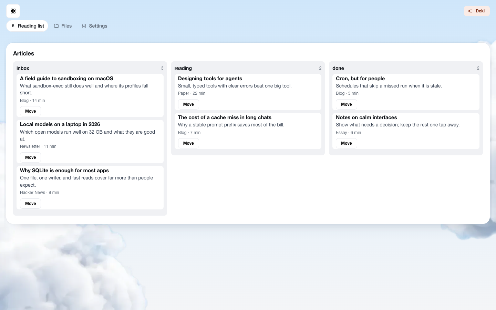
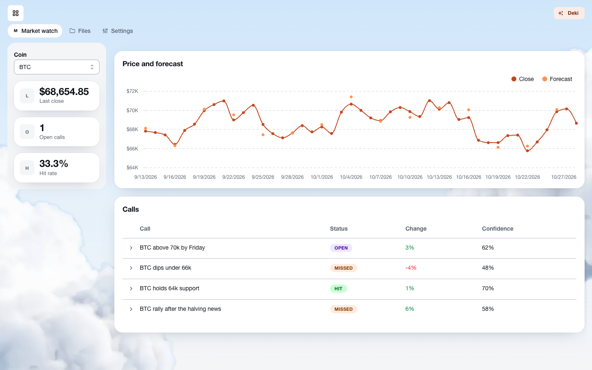
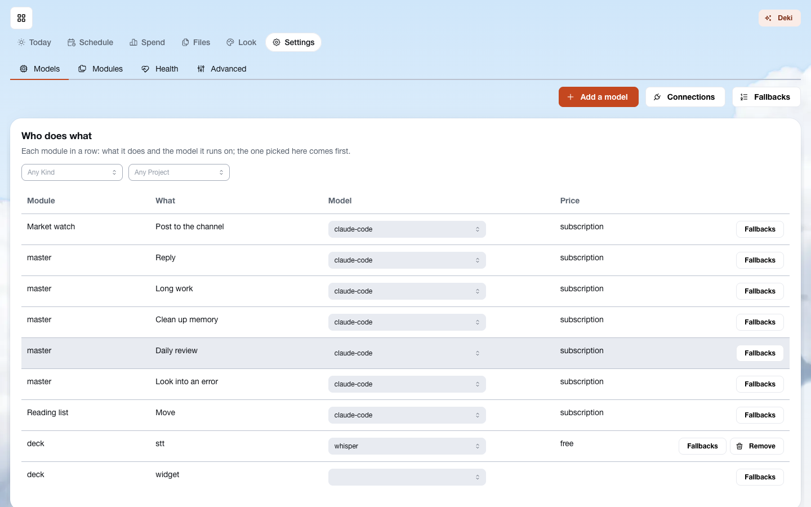
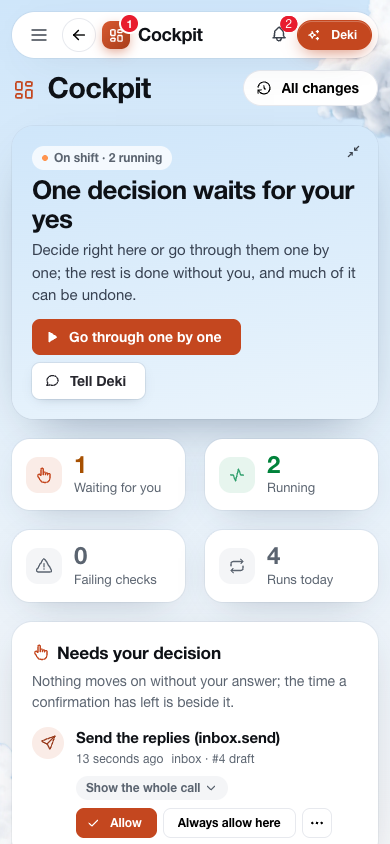
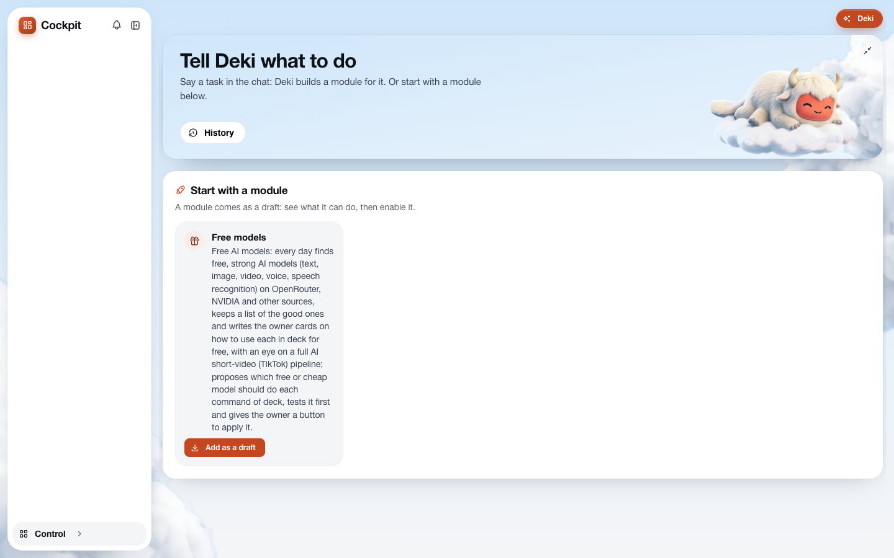
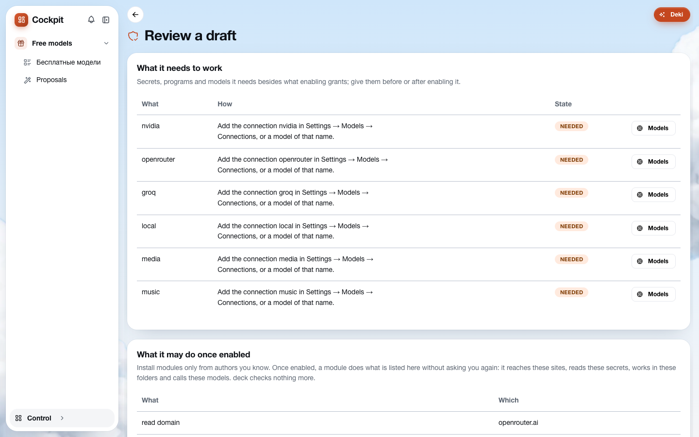

<div align="center">

# deck

### Your own team of AI agents — and one place to run it.

Hand your routines to agents. They work on schedule, in the background, on your machine.
You only step in when something needs your **yes**.


</div>

---

## What is deck?

Chat assistants wait for you to type. **deck makes agents work for you.**

Every routine you have (the inbox, a market you follow, pull requests, research, videos for your channel) becomes
a **module**: a small app with its own data, buttons, schedule and screens. Agents (Claude Code, Codex, or any
open model in the Goose agent) do the work in their own sandbox, and deck shows you the result.

You open **Today** in the morning and see what was done today, what is running, and the one or two things that
wait for your decision. One tap, and the agents carry on.

## Why you'll like it

- **It works while you don't.** Modules run on schedule: the inbox sorted at 8:00, the market read at 7:30, pull
  requests reviewed every two hours. You come back to results, not to a blank chat.
- **Nothing important happens without you, and you say yes once.** Sending a mail, spending money, reaching a new
  site: deck asks first. A button you press is your yes to what its row shows, so Apply just applies; deck asks
  again only when the schedule or an agent wants something. A question that went out of date closes by itself.
  Everything else is in the feed, and much of it can be undone.
- **Just say what you need.** Talk to **Deki**, the master agent, in chat or by voice. It sends a task to the
  right module, builds a new module from a short interview, looks into what failed, and remembers what you told it.
- **Any model, your choice, right in the row.** Claude, GPT, Gemini, open models on OpenRouter or your own machine.
  Pick the model of each command from a dropdown, see what it costs, and keep a subscription apart from the money
  you pay.
- **Yours, on your machine.** One program, one folder. No cloud account, no subscription to deck, no data leaving
  unless you allow it.
- **In your pocket.** Install it on your phone as an app. Get a push when something waits for you, share a file
  or a link straight into a module, and reach it from anywhere over your own Tailscale network.

## A look inside

<table>
<tr>
<td width="50%"><br><sub><b>A module as a board.</b> The inbox,
sorted by an agent; drag a card to change its lane.</sub></td>
<td width="50%"><br><sub><b>Your own dashboards.</b>
Numbers, charts and tables of a module, drawn from its data.</sub></td>
</tr>
<tr>
<td width="50%"><br><sub><b>Every model in one table.</b>
Change the model of any command right in its row.</sub></td>
<td width="50%" align="center"><br><sub><b>On your phone.</b>
The same cockpit, with pushes and sharing.</sub></td>
</tr>
<tr>
<td width="50%"><br><sub><b>The first run.</b>
Tell Deki what you need, or start with a module that finds free models.</sub></td>
<td width="50%"><br><sub><b>A module comes as a draft.</b>
See what it needs and what it may do, then enable it.</sub></td>
</tr>
</table>

## What people run on it

| Module | What the agents do |
|---|---|
| **Inbox** | Sort mail every morning, draft replies, and send only what you approve. |
| **Market watch** | Read prices and news, write calls with their confidence, and check them later. |
| **Code review** | Review open pull requests, work on cards in your repo, and hand them back for review. |
| **Research** | Follow sources, collect what is new, and write a short digest. |
| **Video studio** | Write a script, voice it, and assemble a short clip with local or cloud models. |

You don't write code for a module. Tell Deki what you want, answer a few questions, and it builds the module, a
manifest with prompts and screens. You review what the module may do and enable it. Modules can be **exported to
a file and shared**; whoever installs one sees everything it is allowed to do first.

## Quick start

```bash
go build -tags tailnet -o deck ./cmd/deck
./deck                       # prints the address to open, with your access token (data in ~/.deck2)
./deck -tailscale deck       # or on your own tailnet, over HTTPS, from any device (needs -tags tailnet)
```

You need macOS or Linux, Go 1.27, and an agent CLI on the machine (`claude` or `codex`); add any other model
in Settings → Models. On the desktop, `desktop/build.sh` makes `deck.app` for macOS and `deck-setup.exe` for
Windows, where deck runs inside WSL2: an icon in the tray that starts deck, opens it in its own window and starts
at login (Windows is not yet tried on a real machine; see `docs/spikes/windows.md`). Updating is just replacing the binary: your data and modules carry over. A deck from before
23 October 2026 moves its modules by export and import instead; Deki brings an older manifest to the current
format.

## Under the hood

One Go binary with SQLite and the web client inside, MCP between agents and deck, every run in a sandbox. How it
is built, what a module looks like, and how to build and test it: **[docs/architecture.md](docs/architecture.md)**.

<div align="center">
<sub>A personal project, built in the open. Ideas and issues are welcome.</sub>
</div>
