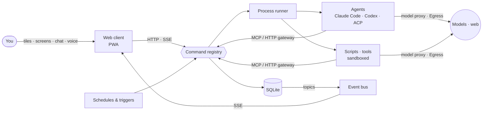

# deck under the hood

How deck is built, what a module looks like, and how to build and test deck. For what deck is, see the
[README](../README.md). The package map and the rules of the code are in [CLAUDE.md](../CLAUDE.md).

## The shape

deck is **one Go binary**. SQLite and the web client are embedded in it, and there are no queues, cloud services
or helper daemons.



**Everything goes through one door.** Buttons, the API, the master agent, schedules, scripts, agents and deck's own
screens all call the same commands through one entry of the gateway. Each call is one `Call` (who, the command, its
input) and goes the same stages: entry → resolve → decide → before → run → after. The owner's own call is a row of the
same table. A tool of an agent's CLI and a call of a model through deck's proxy are no commands, but are decided by
the same gathering of facts (`verdict`) and the same table (`decide`), so rights, confirmations, the journal and the
feed are decided in one place. The owner's yes to a waiting call makes the same call again with the fact of that
answer.


- **Commands.** Every action is a command: `deck.<name>` is built into deck, and `<module>.<name>` comes from a
  manifest. A module declares the rights of deck's catalog it may ask for (network, login, data, files, money, send,
  modules); a call that needs one the owner has not answered waits for the owner's yes, and the answers live apart
  from the manifest. A button you press is your yes to the calls its row lists (`allows`). Changes made without the
  owner go to the feed as one "done without you" line per run, with an undo. A pending ask closes by itself once
  it is no longer needed or what it acts on has changed.
- **What goes out with and without the owner's yes.** Enabling a module answers always to the rights it declares whose
  always takes no passkey: its files and folders, the data of its own tools, the records of deck of the runs and
  models of the modules it names, and the hosts its programs' network right names, which they reach and send to
  without asking. The subscription login, money, sending in the owner's name, other modules, other data of modules, a
  body posted to a tool that reads, the network of agents' shells and every host (`*`) wait for the owner's first
  answer: once, for this work (the process and what it starts), always, or no, which is kept; always to one of them
  takes a passkey. A turn is **marked** when it read text from outside deck (a page, an
  outside tool's answer, data that holds such text, or the network of its box) and holds something of value (a
  subscription login, or the data of its module in a box without network). A marked turn's ways out — sending, money,
  another module, a host its module holds but does not name, a body posted to a tool — and its changes of what an
  enabled module runs go only with the owner's yes to that very call, whatever was allowed always. One exception: the
  owner's start of a work (a press of a button deck drew on the module's screen, or the master's turn of the owner's
  own word that read nothing from outside) is the yes to that work's changes of its own module's prompts, skills and
  scripts, which go to "done without you" with an undo. The hosts its module names stay open, and so does the web for the master when the owner lets it read the web marked (a setting). A
  turn whose box has network and no login is never marked: it may already send its data to those hosts. The own web
  search of Claude Code and Codex runs outside deck and does not mark a turn; it is off on Linux (deck's image) and on
  on macOS (a deck without Docker or a Mac node).
- **Store and events.** One writer transaction at a time, with readers apart. Every committed write publishes the
  topic of its table on the bus. A screen read declares its topics, so the client refreshes over SSE only when
  that data changes, without polling.
- **Process runner.** It starts agent turns, scripts, HTTP and MCP tools and model calls, each in its own work
  folder. Agent turns take slots and the rest wait. The runner handles deadlines and resume. When a turn is
  refused or goes silent, it hands the turn to the next model of the assignment.
- **Providers.** One interface with one outcome of a turn: `claudecode` (the Claude Code CLI), `codex` (Codex
  app-server, a generated protocol) and `acp` (an ACP agent such as Goose, run in deck's sandbox on a model reached
  through deck's proxy). Each has a self-check; a red one is checked again every 30 minutes. A built-in CLI that is
  not installed is off by itself (no check, no work, its models not offered), and the owner may turn an installed
  one off (`deck.provider_switch`).
- **Gateway.** Each process gets deck's MCP server. It exposes the module's commands as tools, questions and
  confirmations to the owner, and the deck commands the module may call. Scripts reach deck over an HTTP entry with
  a per-run token. The model proxy holds the keys, so a module never sees one. `Egress` is the only way out to the
  web: a name resolves once, and only public addresses, or those the module's hosts name, are dialed.
- **Tools and secrets.** A module reaches a service through HTTP tools of its manifest (method, URL template, headers,
  body, input and result schemas) and MCP servers deck starts for it. A secret goes into a header as
  `$secret.<name>`, or is the whole URL of a private link (`"url": "$secret.<name>"`) limited to exact `hosts` and
  https. deck cuts every secret, in any echoed form, out of answers, errors, health and the journal.
- **Files.** What a run leaves in its results folder becomes stored files of its process or record. A process may
  delete the files its own run made and those of its module's records and data folder; each is a line of "done
  without you" with an undo.
- **Sandbox.** Every foreign program — a script, an MCP server, Claude Code, Codex, an ACP agent — runs through
  one function, `sandbox.Run(Box)`: bubblewrap on Linux and in deck's image; on a Mac (a node, or a deck without
  Docker) scripts, MCP servers and ACP agents run under `sandbox-exec`, while Claude Code, Codex and deck's browser
  run outside it, as the owner's. A box's only network path is the `Door` to deck's proxy. A process sees its own folder,
  the folders the owner granted and the environment deck gives it; bubblewrap mounts each folder by the file deck
  opened, through links of the system only, so a folder turned into a link after deck checked it leads nowhere. In
  the image deck runs as `deck` without capabilities, and `compose.yaml` gives the container `seccomp.json`,
  `systempaths=unconfined` and the AppArmor profile `deck-box`; without them deck starts no foreign program and
  health names the lines.
- **Nodes.** deck in a container reaches the models, agents and folders of another machine through a node: the same
  binary there (`deck -join … --install`) holds one outgoing connection, over which deck speaks HTTP/2 to it. The
  node keeps its own list of what deck may use (ports of its loopback, agents, folders). A model connection with a
  node goes through it; a turn of `<agent>@<node>` or of a folder of the node runs there in the node's box, with a
  copy of its run folder and the module's data, which come back to deck at its end; the scripts of a module whose
  folders are on a node run there too. A node away makes a call go to the next model and a turn or script wait.
- **Screens are data.** The server resolves a stored screen into [A2UI](https://github.com/google/A2UI) messages
  from a block catalog (`schemas/catalog.json`): tables, lists and boards, cards, forms, stats, charts, media, a
  file manager, tabs, columns and dialogs. A screen can also have a side panel. The client only draws them, and a
  button sends an A2UI action back. Anything the catalog lacks, a model writes as an MCP App: a `custom` block in a
  sandboxed frame on a second origin. deck's own screens (Today, Schedule, Spend, Files, Look, Settings, the chat, a
  process, a draft, a module's settings, the report of rights, …) are data as well, in `internal/app/screens/shipped/`; what deck says to people is one dictionary, `internal/words/ru.json`.
- **Tiles and widgets.** The home grid stores one layout per device and number of columns: free sizes in cells,
  written by the grid and by Settings → Modules alike. A widget is a small screen, not a new kind of data: up to
  eight views in a manifest, each with a least size (`2x1`) and up to four `stat`, `list` and `chart` blocks, read
  through the same path and topics as a screen. The card shows the largest view that fits (a phone has two cells
  across) and refreshes over SSE; the server gives every block of the view, the client lays them in the card's
  height on the device: a chart grows over the room left, a block without room wraps out of sight and the card
  names it. For a size without a view, the card's button asks Deki in the chat (`deck.chat_send`, the
  size in the message's screen) to write one into the manifest, on the model of the role `widget`. Today is deck's own widget of the same blocks.
- **Models are settings.** Connections (OpenRouter, Google, Anthropic, Groq, any OpenAI-compatible or local
  server), models with kinds and prices, and assignments with fallbacks are declared once in deck. Each command
  of a module, and each role of the master, has its own model. Subscriptions are shown apart from money paid. A usage
  limit pauses what its answer speaks of (a model, every free model of an OpenRouter connection, or a subscription's
  login, whose 5-hour and weekly windows Health shows; new turns go to the next model at 98 %), and a call skips a
  paused model. Search is a model of kind search too: SearXNG beside deck, and a search whose engines do not answer
  fails and hands the query to the next search of the role.
- **The master.** Deki is a built-in project (`master/`): its prompts, skills and commands such as reply, long
  work, daily review and memory upkeep. It works through the same registry with its own rights. It builds and
  changes modules with the skills in `skills/`: `module-builder` (what a manifest can do), `module-conventions` (the
  layout, script contract, checks and review of a module's code), `code-project` and `memory`. What deck ships (the master and the skills) one
  function lays out on start, `docs.Ship`: another's edit merges into deck's new text; in a conflict deck's text wins
  over an agent's and the owner's over deck's, with a note to the master; a file deck ships no more goes if deck wrote
  its last revision.
- **Memory.** Memory is documents: the facts of the owner in `memory/` of the project `master`, each project's own in
  its `memory/`, with an index (`MEMORY.md`) that reaches the prompts as data. A fact of `type: lesson` is what an
  agent learned; the lessons of a command reach its next runs. `deck.memory_search` finds words in memory, and the
  master's nightly `sleep` confirms or retires lessons and proposes corrections; Settings → Memory shows it all
  (`deck.memory_map`).
- **Blocks in the chat.** A reply turn of the master may show one block of the catalog under its text
  (`deck.chat_block_show`: options, a form, a table, a chart or a card). Options and a form are an ask of the broker,
  as every question to the owner: they wait in the topic and on Today alike, and the answer, given in either, comes
  back to the topic as the owner's next message.
- **Failures** have one form (`internal/fault`): a type from a closed set, whose failure it is, a text and
  details. A script reports its own failure as `{"error", "type", "details"}`.

## Rights, requests and trust

What the owner sees of the rules above, on three screens.

- **The request card.** What waits for the owner is a card on Today and in the chat topic that made it, one at a
  time. It heads with the module that asks and the module the call changes and what changes, in deck's words
  («master → tyres: change prompt.md»), then why the caller asks in its own words, then why it waits: the row of the
  table of decisions it took and, for a marked turn, where the text from outside came from in short (the data of the
  module it last passed through and its first source; the whole chain is under Details). A change of a prompt, skill
  or script shows its diff, the call's input folded under Details. The buttons are «Allow once: <what>», «Deny» (or
  «No, and do not ask again», which keeps the no), «For this work» (this run and what it starts), «Always let
  <module>: …» where always may be given, «Deny because…» (the reason goes back to the agent) and «Rights»; «Later»
  on Today leaves it waiting and shows the next. The requests of one work are one card with each part's buttons and
  buttons for all.
- **Rights** (Settings → Rights) lists every right of every module, by module or by right: what it lets the module
  do, why in the module's words, the answer (always and since when, no, or asks you, and whether always takes the
  passkey) and when it was last used. Revoke, at one tap, turns an always back into asks you; Allow always and Say no
  answer ahead; Ask again clears a no. The master's rights
  are deck's own, without buttons. **Report** of a module (`deck.project_report`, the screen `rights-report`) says
  what it did in a period by the rights: the hosts reached with how many requests, the calls that needed a right,
  made or refused, turns on a login, paid model calls and turns that read text from outside. A draft's page says
  how many rights enabling gives and how many ask first, with a button to Rights.
- **«I checked it: trust».** A module whose data holds text from outside deck says so, and where it came from, on
  the tab Module of its settings, and every turn that reads that data is marked by it. Once the owner has read the
  data and found nothing in it that instructs an agent, the button «I checked it: trust» there (or the dialog «Trust
  the data of a module» on Settings → Rights; `deck.project_trust`, with the passkey) takes the mark off:
  later turns that read it are not marked for it; a turn marked already stays marked. What an automation token
  writes is text from outside too; «I checked it: trust» on its row (Settings → Advanced, `deck.token_trust`, with
  the passkey; «Do not trust» takes it back) makes its words the owner's. Trust a module's data when its outside text
  came once (an import, a file you gave it) and you read it; for a module that reads the web it lasts only until its
  next run marks the data again. Trust a token when you control what it writes, such as your own shortcut.

## A module

A module is a manifest, documents (prompts, skills), scripts and screens. It contains no Go code.

```json
{
  "version": 17,
  "title": "Reading list",
  "collections": [{"name": "items", "key": "title", "description": "An article.",
    "schema": {"type": "object", "properties": {"title": {"type": "string"},
      "status": {"type": "string", "enum": ["inbox", "reading", "done"]}}}}],
  "commands": [{
    "name": "collect", "title": "Collect",
    "description": "Reads the feeds and adds new articles.",
    "input": {"type": "object"},
    "executor": {"type": "agent", "prompt": "Read my feeds and add today's articles to items."}
  }],
  "triggers": [{"command": "collect", "cron": "0 8 * * *", "skip_missed": true}],
  "screens": [{"name": "board", "title": "Reading list", "blocks": [
    {"type": "list", "title": "Articles", "source": {"collection": "items"}, "item": {"title": "title"}}]}],
  "widgets": [{"min": "1x1", "blocks": [{"type": "stat", "title": "To read", "source": {"collection": "items", "where": "status == 'inbox'"}}]}],
  "menu": ["board"]
}
```

The schema is `schemas/manifest.json`. A command can run an agent, a script, an HTTP or MCP tool, or a model call. A
script is Python, run by `uv run --script` on deck's one Python (3.11 in the image), which installs the packages of
its PEP 723 block through deck's proxy. A
trigger runs a command on a cron schedule or after another command. `rights` lists what the module may ask the owner
for, each with why; a declaration grants nothing, enabling a module grants what "What goes out with and without the
owner's yes" above says, the rest asks the first time. A new restriction warns when a manifest is read and fails only
when it is saved. A new format comes with a migration that rewrites the stored manifests.

Deki builds modules from an interview with the `module-builder` skill
([skills/module-builder](../skills/module-builder/SKILL.md)). A module exports to a `.zip` without secrets,
records or data, and imports from one as a draft. The owner reads what the draft may do before enabling it.

## Build and run

You need Go 1.27 and at least one agent CLI on the machine (`claude` or `codex`). Node.js is needed only to rebuild
the client. Installing and running deck for use is Docker ([install](install.md)); nodes are in [node.md](node.md).

```bash
go build -tags tailnet -o deck ./cmd/deck   # without the tag: no tailnet, a smaller binary
DECK_HOME=/tmp/deckhome ./deck              # prints http://deck.localhost:7700 and the first link (default home ~/.deck2)
cd web && npm ci && npm run build           # type check and rebuild the embedded client (web/dist)
sqlc generate                               # after editing internal/store/queries or migrations
```

To build for another Mac with Apple silicon:
`GOOS=darwin GOARCH=arm64 CGO_ENABLED=0 go build -tags tailnet -trimpath -o deck ./cmd/deck` (the SQLite driver
is pure Go). On start, deck migrates the database and the stored manifests to the current format.

**Releases and updates.** A tag `v*` runs `.github/workflows/release.yml`. It builds deck for macOS arm64 and Linux
amd64/arm64, each with and without the tailnet.
`cmd/deck-release` writes `release.json` with the size and sha256 of each file and signs it with the ed25519 key in
the secret `DECK_RELEASE_KEY` of the GitHub environment `release`. The public key is `internal/release/release.pub`, built into deck. `-ldflags -X deck2/internal/release.Version=…` sets the version; `deck -version`
prints it with the build. `internal/app/updates` reads the latest list once a day through `egress.Fetch` and keeps
the health row `update`. Its `deck.update_install` puts the binary of its build in place and restarts deck with
`syscall.Exec` after a full stop. It takes a snapshot first and keeps the old binary until the new deck serves
(`state/update.json`). A start that finds that update already tried goes back to the old binary.

A tag runs only on a commit of master that CI made green.

**Server image.** Before the release the same workflow builds `Dockerfile` on native amd64 and arm64 runners and
pushes `ghcr.io/teaarte/deck:<version>` and `:latest`. `compose.yaml` runs it on 127.0.0.1:7700 and 7701, where a browser of
the machine opens deck at deck.localhost; with a domain (`DECK_DOMAIN` and the profile `domain`) Caddy is in front,
HTTPS on 443 and the second origin on 8443, deck takes `-public` and X-Forwarded-For only from Caddy (`-proxy caddy`); a request from any other address,
loopback and the gateway of its docker network too, counts by the address it came from;
optionally on the tailnet (`DECK_TAILSCALE`, going away: the README says how to move off it). A deck in an image (`DECK_IMAGE`) does not replace itself: a newer one is a newer image.
Claude Code and Codex are signed in from Settings → Models (`deck.agent_login`); their logins live in the volume
`deck`, one for all projects (`agents/<cli>/login`); a second subscription of a CLI is a connection of its own
(`deck.connection_set` with `api: cli`, such as `claude-code-2`) with its own sign-in. `move-to-docker.sh` brings the folder of a deck that ran
without Docker into that volume.

## Tests

These are scenario tests through the real registry and gateway, on a real SQLite in a temp dir, with a fake
provider. The only exception is the contract tests of each provider adapter, which run on recorded streams.

```bash
go test -race -timeout 30m ./...
DECK_REAL_BROWSER=1 go test ./tests/scenarios/browser -run TestRealBrowser -v   # the client in a real browser
DECK_REAL_CLI=1 go test ./tests/scenarios/real -run TestRealClaudeCode -v    # the real Claude Code
DECK_LINUX=1 go test ./tests/linux -v                                   # bubblewrap and deck's image user, in docker
DECK_SERVER=1 go test ./tests/scenarios/real -run TestServerFromScratch -v   # compose.yaml on a bare docker
```

The runs against Codex, ACP agents on local models and package installs are listed in
[CLAUDE.md](../CLAUDE.md). The code rules (`internal/lint`) are checked by `go test ./tests/lint`.

## Stack

Go · SQLite (modernc, sqlc, goose) · MCP (go-sdk) · React + Vite + Mantine v9 + A2UI v0.9 · MCP Apps
(`@modelcontextprotocol/ext-apps`) · `sandbox-exec` / bubblewrap · tsnet.
