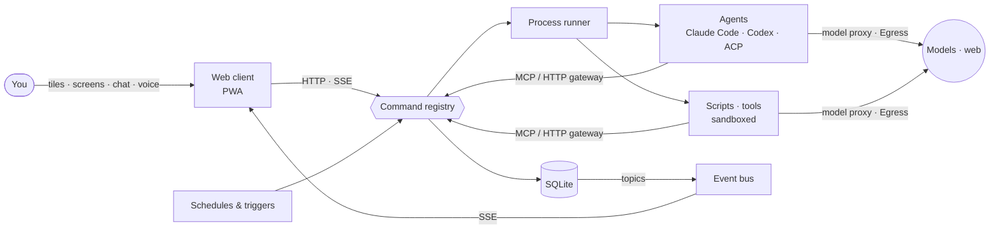

# deck under the hood

How deck is built, what a module looks like, and how to build and test deck. For what deck is, see the
[README](../README.md). The full spec (in Russian) is [spec.md](spec.md). The package map and the rules of the
code are in [CLAUDE.md](../CLAUDE.md).

## The shape

deck is **one Go binary**. SQLite and the web client are embedded in it, and there are no queues, cloud services
or helper daemons.



**Everything goes through one door.** Buttons, the API, the master agent, schedules, scripts and agents all call
the same commands through the registry. Rights, confirmations, the journal and the feed are therefore enforced in
one place.

- **Commands.** Every action is a command: `deck.<name>` is built into deck, and `<module>.<name>` comes from a
  manifest. A command has a class. A call that leaves the machine, spends money or widens rights waits for the
  owner's yes. A button you press is your yes to the calls its row lists (`allows`). Changes made without the
  owner go to the feed as one "done without you" line per run, with an undo. A pending ask closes by itself once
  it is no longer needed or what it acts on has changed.
- **Store and events.** One writer transaction at a time, with readers apart. Every committed write publishes the
  topic of its table on the bus. A screen read declares its topics, so the client refreshes over SSE only when
  that data changes, without polling.
- **Process runner.** It starts agent turns, scripts, HTTP and MCP tools and model calls, each in its own work
  folder. Agent turns take slots and the rest wait. The runner handles deadlines and resume. When a turn is
  refused or goes silent, it hands the turn to the next model of the assignment.
- **Providers.** One interface with one outcome of a turn: `claudecode` (the Claude Code CLI), `codex` (Codex
  app-server, a generated protocol) and `acp` (an ACP agent such as Goose, run in deck's sandbox on a model reached
  through deck's proxy).
- **Gateway.** Each process gets deck's MCP server. It exposes the module's commands as tools, questions and
  confirmations to the owner, and the deck commands the module may call. Scripts reach deck over an HTTP entry with
  a per-run token. The model proxy holds the keys, so a module never sees one. `Egress` is the only way out to the
  web: a name resolves once, and only public addresses are dialed.
- **Sandbox.** Scripts, MCP servers and ACP agents run under `sandbox-exec` on macOS or bubblewrap on Linux. The
  only network path is the `Door` to deck's proxy. A process sees its own folder, the folders the owner granted
  and the environment deck gives it.
- **Screens are data.** The server resolves a stored screen into [A2UI](https://github.com/google/A2UI) messages
  from a block catalog (`schemas/catalog.json`): tables, lists and boards, cards, forms, stats, charts, media, a
  file manager, tabs, columns and dialogs. A screen can also have a side panel. The client only draws them, and a
  button sends an A2UI action back. Anything the catalog lacks, a model writes as an MCP App: a `custom` block in a
  sandboxed frame on a second origin. deck's own screens (Today, Schedule, Spend, Files, Look, Settings) are data
  as well, in `internal/app/screens/shipped/`.
- **Tiles and widgets.** The home grid stores a layout for each device and each number of columns. A module card
  shows the largest of its manifest's `widgets` views that fits the card (`stat`, `list` and `chart` blocks). When
  a size has no view, Deki can draw one on request.
- **Models are settings.** Connections (OpenRouter, Google, Anthropic, Groq, any OpenAI-compatible or local
  server), models with kinds and prices, and assignments with fallbacks are declared once in deck. Each command
  of a module, and each role of the master, has its own model. Subscriptions are shown apart from money paid.
- **The master.** Deki is a built-in project (`master/`): its prompts, skills and commands such as reply, long
  work, daily review and memory upkeep. It works through the same registry with its own rights. It builds and
  changes modules with the skills in `skills/` (`module-builder`, `module-conventions`, `code-project`,
  `memory`).
- **Failures** have one form (`internal/fault`): a type from a closed set, whose failure it is, a text and
  details. A script reports its own failure as `{"error", "type", "details"}`.

## A module

A module is a manifest, documents (prompts, skills), scripts and screens. It contains no Go code.

```json
{
  "version": 13,
  "title": "Reading list",
  "collections": [{"name": "items", "key": "title", "description": "An article.",
    "schema": {"type": "object", "properties": {"title": {"type": "string"},
      "status": {"type": "string", "enum": ["inbox", "reading", "done"]}}}}],
  "commands": [{
    "name": "collect", "title": "Collect", "class": "internal",
    "description": "Reads the feeds and adds new articles.",
    "input": {"type": "object"},
    "executor": {"type": "agent", "prompt": "Read my feeds and add today's articles to items."}
  }],
  "triggers": [{"command": "collect", "cron": "0 8 * * *", "skip_missed": true}],
  "screens": [{"name": "board", "title": "Reading list", "blocks": [
    {"type": "list", "title": "Articles", "board": "status", "source": {"collection": "items"}, "item": {"title": "title"}}]}],
  "widgets": [{"min": "1x1", "blocks": [{"type": "stat", "title": "To read", "source": {"collection": "items", "where": "status == 'inbox'"}}]}],
  "menu": ["board"]
}
```

The schema is `schemas/manifest.json`. A command can run an agent, a script, an HTTP or MCP tool, or a model
call. A trigger runs a command on a cron schedule or after another command. `domains`, `writes`, secrets and
folders are rights the owner grants. A new restriction warns when a manifest is read and fails only when it is
saved. A new format comes with a migration that rewrites the stored manifests.

Deki builds modules from an interview with the `module-builder` skill
([skills/module-builder](../skills/module-builder/SKILL.md)). A module exports to a `.zip` without secrets,
records or data, and imports from one as a draft. The owner reads what the draft may do before enabling it.

## Build and run

You need Go 1.27 and at least one agent CLI on the machine (`claude` or `codex`). Node is needed only to rebuild
the client.

```bash
go build -tags tailnet -o deck ./cmd/deck   # without the tag: no tailnet, a smaller binary
DECK_HOME=/tmp/deckhome ./deck              # prints the URL with the access token (default home ~/.deck2)
./deck -tailscale deck                      # the same on your tailnet over HTTPS
cd web && npm ci && npm run build           # type check and rebuild the embedded client (web/dist)
sqlc generate                               # after editing internal/store/queries or migrations
```

To build for another Mac with Apple silicon:
`GOOS=darwin GOARCH=arm64 CGO_ENABLED=0 go build -tags tailnet -trimpath -o deck ./cmd/deck` (the SQLite driver
is pure Go). On start, deck migrates the database and the stored manifests to the current format.

The desktop launcher (`desktop/`, Wails) is a separate Go module. deck itself knows nothing about it.
`desktop/build.sh` makes `deck.app` and the Windows installer, which runs deck in a WSL2 distribution
([spikes/windows.md](spikes/windows.md)).

## Tests

These are scenario tests through the real registry and gateway, on a real SQLite in a temp dir, with a fake
provider. The only exception is the contract tests of each provider adapter, which run on recorded streams.

```bash
go test -race -timeout 30m ./...
DECK_REAL_BROWSER=1 go test ./tests/scenarios -run TestRealBrowser -v   # the client in a real browser
DECK_REAL_CLI=1 go test ./tests/scenarios -run TestRealClaudeCode -v    # the real Claude Code
DECK_LINUX=1 go test ./tests/linux -v                                   # bubblewrap, in docker
```

The runs against Codex, ACP agents on local models and package installs are listed in
[CLAUDE.md](../CLAUDE.md). The code rules (`internal/lint`) are checked by `go test ./tests/lint`.

## Stack

Go · SQLite (modernc, sqlc, goose) · MCP (go-sdk) · React + Vite + Mantine v9 + A2UI v0.9 · MCP Apps
(`@modelcontextprotocol/ext-apps`) · `sandbox-exec` / bubblewrap · tsnet · Wails (desktop launcher).
