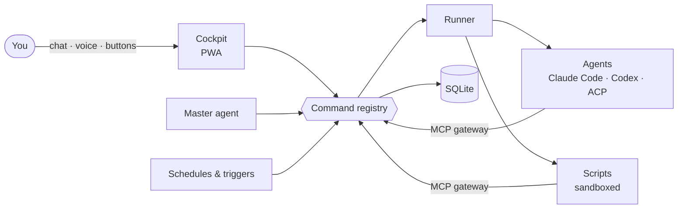

# deck under the hood

The technical side of deck: how it is built, how a module looks, and how to build, run and test it. For what
deck is and why, see the [README](../README.md). The full spec (in Russian) is [spec.md](spec.md); the map of the
code is [CLAUDE.md](../CLAUDE.md).

## The shape

deck is **one Go binary** with SQLite and the web client embedded. No queues, no cloud, no services of its own.



**One door for everything.** Buttons, the master agent, schedules, scripts and agents all call the same commands
through the same gateway, so rights, limits, confirmations and the journal live in one place.

- **Command registry.** Every action is a command: `deck.<name>` built into deck, or `<module>.<name>` from a
  manifest. Each has a class (`internal`, `external`, …); what leaves the machine, spends money or widens rights
  waits for the owner's yes. A button names the calls its press is the yes to (`allows`): the run it starts makes
  exactly those without asking, listed in the feed with their undo; money, secrets and rights stay apart. A call
  waiting for a yes closes by itself once what it would make is in force, or as out of date once what it acts on
  changed, and the caller hears it.
- **Runner.** Starts agent turns and scripts, each in a folder and a sandbox of its own (`sandbox-exec` on macOS,
  bubblewrap on Linux). Agent turns take slots; the rest wait.
- **MCP gateway.** Each run gets deck's MCP server: its module's commands as tools, questions and confirmations
  to the owner, and the models of deck's settings through deck's proxy, so a module never holds a key.
- **Screens are data.** The server resolves a screen into [A2UI](https://github.com/google/A2UI) messages from a
  block catalog (tables, lists and boards, cards, forms, charts, media, a file manager); the client only draws.
  What the catalog lacks, a model writes as an MCP App (a `custom` block in a sandboxed frame).
- **Models are settings.** Connections (OpenRouter, Google, Anthropic, any OpenAI-compatible server, local ones),
  models with prices, and assignments with fallbacks are declared once in deck. A model is picked per command in
  its row; a subscription is shown apart from the money paid.

## A module

A module is a manifest, documents (prompts, skills), scripts and screens. No Go code.

```json
{
  "version": 13,
  "title": "Morning digest",
  "commands": [{
    "name": "digest", "title": "Morning digest", "class": "internal",
    "description": "Reads the sources and writes a short digest.",
    "input": {"type": "object"},
    "executor": {"type": "agent", "prompt": "Read my sources and write today's digest."}
  }],
  "triggers": [{"command": "digest", "cron": "0 9 * * *"}]
}
```

The master agent builds modules from an interview with the module-builder skill
([skills/module-builder](../skills/module-builder/SKILL.md)); a code repo is the code-project skill. A module
exports to a `.zip` (without secrets, data or records) and imports from one as a draft, which the owner enables
after reading what it may do.

## Build and run

You need Go 1.27, and at least one agent CLI on the machine (`claude` or `codex`); Node only to rebuild the client.

```bash
go build -tags tailnet -o deck ./cmd/deck   # without -tags tailnet deck has no tailnet and is smaller
DECK_HOME=~/.deck ./deck            # prints the URL with the access token
./deck -tailscale deck              # the same on your tailnet over HTTPS (a build with -tags tailnet)
cd web && npm ci && npm run build   # rebuilds the embedded client (web/dist)
```

A build for another Mac with Apple silicon: `GOOS=darwin GOARCH=arm64 CGO_ENABLED=0 go build -tags tailnet -trimpath -o deck ./cmd/deck`
(SQLite is pure Go). Updating is replacing the binary: the base and the manifests of modules are raised to the new
format on start. A deck from before 23 October 2026 moves its modules by export and import instead.

## Tests

Scenario tests through the real gateway on a real SQLite, with a fake provider; real-browser runs with Playwright.

```bash
go test -race -timeout 30m ./...
DECK_REAL_BROWSER=1 go test ./tests/scenarios -run TestRealBrowser -v
DECK_REAL_CLI=1 go test ./tests/scenarios -run TestRealClaudeCode -v
```

More runs against real agents, models and Linux are listed in [CLAUDE.md](../CLAUDE.md).

## Stack

Go · SQLite (modernc, sqlc, goose) · MCP (go-sdk) · React + Vite + Mantine v9 + A2UI · `sandbox-exec` / bubblewrap ·
tsnet.
